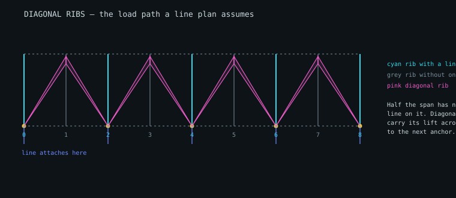

# Diagonal ribs

Chapter 7 of the handbook is figures without text, so this is a reconstruction
from the drawings and from what the geometry has to do.

---

## 1. The project already needed them

Every line attachment is a point of drag and a point of load, so modern wings
attach lines to every second or third rib rather than to all of them. The line
plans here already do exactly that — `everyNthRib: 2` has been the default
since line plans were built.

That left a problem the line plan quietly assumed away. **The ribs with no line
on them still carry lift**, and it has to reach the lineset somehow. A diagonal
rib is what carries it: a triangular panel from the attachment point on a
loaded rib, diagonally across the cell, to a line along the upper surface of
the unloaded rib beside it. Load spreads from a line of fabric down to a point.

So diagonals are not an optional refinement. Without them, a wing whose lines
attach every second rib has half its span hanging on nothing — and the tool was
modelling exactly that wing.



*Cyan ribs carry a line; grey ribs do not. Each pink triangle runs from an
attachment point on a loaded rib up to the upper surface of its unloaded
neighbour. Generated from the tool's own geometry by `tools/make-diagrams.mjs`.*

---

## 2. The flat pattern is exact

A diagonal is a fan: one apex, and a base curve on the neighbouring rib's
surface. That is a cone, and **a cone is developable** — it flattens with no
distortion at all, unlike the wing's own panels, whose development is only
approximate and has to have its error measured.

The development follows directly. Place the apex, lay each base point at its
true distance from it, and take the angle between successive base points from
the triangle they form:

```
cos(dφ) = (r_k² + r_k₊₁² − s²) / (2 · r_k · r_k₊₁)
```

Every radius and every base segment then comes out exact. Measured on a
synthetic fan and on a real diagonal from a built wing, the worst error is
**4.4 × 10⁻¹⁶ m** — machine precision, and the tolerance is set there rather
than at something discovered empirically. If it ever drifts, the fan is not
being treated as the developable surface it is.

---

## 3. Half the load travels diagonally

Every unloaded rib's lift must reach an attachment point, and the diagonals are
the only route. With lines on every second rib, **half the half-wing's load
travels diagonally**.

That number is a check, not an output. A first implementation returned 25%,
because it applied a row share on top of an already-normalised proximity
weight — dividing the load twice and losing half of it. The load has to arrive
somewhere, so anything other than 50% at `everyNthRib: 2` means it is being
lost or counted twice.

`vribLoads` also reports **load per metre of seam**, which is what decides
whether a seam needs reinforcing: about 2 daN/m on the test wing, rising to
4 daN/m when attachments are spread further apart.

---

## 4. The trade-off, made visible

Fewer attachments means less line drag and fewer anchor points, paid for in
fabric, weight and seam loading:

| lines every | reach | attach ribs | diagonals | extra fabric | load via diagonals | peak seam |
| --- | --- | --- | --- | --- | --- | --- |
| 1 rib | — | 25 | 0 | 0.00 m² | 0% | — |
| 2 ribs | 1 cell | 13 | 48 | 2.68 m² | 50% | 2.1 daN/m |
| 3 ribs | 1 cell | 9 | 32 | 1.79 m² | 67% | 4.1 daN/m |
| 4 ribs | 1 cell | 7 | 24 | 1.34 m² | **50%** | 4.1 daN/m |
| 3 ribs | 2 cells | 9 | 64 | 4.82 m² | 67% | 2.8 daN/m |
| 4 ribs | 2 cells | 7 | 48 | 3.62 m² | 75% | 4.1 daN/m |

The row that matters is **every 4th rib with single-cell diagonals**. It looks
cheapest — fewest diagonals, least fabric — and it is not buildable: a
single-cell diagonal cannot reach the middle of a three-cell gap, so six ribs
end up carrying no load path at all. `unsupportedRibs` names them.

That is a genuine rigging constraint rather than a modelling limit, and it is
where a designer finds out that spreading attachments further requires longer
diagonals. Reaching two cells fixes it and costs 2.7× the fabric of the
unbuildable version.

---

## 5. Cutting them

Diagonals cost fabric and have to be cut like anything else. `vribsToDXF`
nests them and writes R12, and they appear in the interface as their own
export.

They nest **separately from the panels**, for a practical reason: diagonals
are usually cut from a different, lighter cloth than the sail, so mixing them
into one layout produces a cutting file nobody can use.

They also nest differently. A sail panel is long and narrow and wants to lie
along the roll; a fan is a wedge. The existing nester copes without changes
because it searches orientations against the real outline rather than the
bounding box, so a wedge turned through 180 degrees interlocks with its
neighbour. On the test wing, 48 diagonals take 4.28 m of a 1.4 m roll at 45%
utilisation.

One number is worth checking every time: the **flat-pattern area equals the
surface area exactly**. A cone develops with no change of area, so 2.68 m² of
diagonal becomes 2.68 m² of pattern. On the wing's own panels that equality is
only approximate. Here it is exact, and it is the same developability property
appearing a third way — after the radii and the base segments.

## 6. In the interface

The **Rib** tab draws the diagonals that touch the selected rib, and a builder
needs both marks: the point where a diagonal's apex lands on a loaded rib, and
the line along which its base is sewn to an unloaded one. The caption counts
both — how many leave this rib, and how many land on it.

`unsupportedRibs` is surfaced in the status bar as a warning, so a rigging
choice that leaves span with no load path is visible while it is being made
rather than discovered later.

---

## 7. Not covered

- **VH-ribs.** LEP section 12 carries all three types; the V and H forms are
  generated, the combined VH form is not.
- **Diagonal ribs as structure.** They are treated as load paths and cut
  patterns, not as members with stiffness. Whether a diagonal is in tension
  across its whole width, or slack over part of it, is not modelled.
- **The effect on the rib itself.** A diagonal pulls on the rib it lands on,
  and that load is carried by the rib fabric and its reinforcement. The rib
  cut is unchanged here.
- **Collision checking between internal parts.** Diagonals, cross-ports and
  lightening holes are each generated correctly and independently, and nothing
  checks that two of them are not asked for on the same part of a rib.
  `checkTabClearance` does exactly this for tabs against lightening holes; the
  equivalent for diagonals does not exist.

---

## 8. What the H form exposed

The H-rib was implemented expecting it to show a development distortion the V
form does not, since a strip between two curves is not generally developable
while a cone always is.

It showed none. Nor, on investigation, did the sail panels it was being
compared against — at any rib spacing from 0.23 m to 4.1 m, on a wing with 9
degrees of washin and a strongly arced lobe. Surfaces that are certainly not
developable were reporting machine precision.

The measure was at fault, not the geometry. Each unrolling step preserves five
of the quadrilateral's six lengths, including **both** diagonals, and
`developmentError` was comparing one of those diagonals. It could not return
anything but zero, and had been doing so since Phase 1 — through the status
line, through the test suite's loose `< 1%` tolerance, and through every
validation run.

Measuring the fourth side instead — the one length the construction actually
gives up — reports 0.0034% on a normal wing, exactly zero on a cylinder and a
cone, and a figure that grows with the twist of a ruled surface. The H form
does carry a small distortion after all, and the V form genuinely carries none.

The test is now two-sided. A measure that only ever returns zero passes any
one-sided check, so it has to be shown reporting something where something is
there.

---

## 9. Is the diagonal actually in tension?

`vribLoads` says where a diagonal's load **goes**: from the anchor at the apex
to the rib along the base. It does not say how the cloth **carries** it, and
that is a different question.

Fabric carries tension and nothing else — no compression, no bending. So load
flows only along lines from the apex that are being pulled. A part of the
triangle whose fibres are not in tension carries nothing at all: it is sewn
in, it adds weight, and it does no work.

### The limit is the angle

A fibre from the apex to a point on the base carries a share of the load
proportional to the cosine of its angle from the load direction. **Past 90
degrees that share is negative** — the fibre would have to push — so it goes
slack. Asserted in both directions: every slack fibre is past 90°, every taut
one is not.

### Width is the lever

| base spread | area | fully taut | worst | max angle |
| --- | --- | --- | --- | --- |
| 8% chord | 0.057 m² | **20 of 20** | 100% taut | 11° |
| 18% | 0.128 m² | 16 of 20 | 75% | 130° |
| 30% | 0.214 m² | 15 of 20 | 67% | 140° |
| 45% | 0.325 m² | 14 of 20 | 58% | 143° |

A narrow diagonal works across its whole width. A wide one is carrying on a
fraction of itself while paying for all of it — nearly six times the fabric at
45% for a triangle that works on 58% of its base.

`checkDiagonalTension` reports the slack area directly, because that is the
number a designer can act on: it is either too wide or anchored in the wrong
place, and both are things they can change.

### A parameter that was silently ignored

My first run gave identical results for every width, because the option is
`baseSpread` and I passed `spread`. The extra key was accepted and dropped,
so four different calls built the same diagonal and the model looked
insensitive to the thing it was measuring.

Same shape as the `demoWing({ cells: 40 })` error two rounds ago and the
`thinAirfoil` one before that: a call that looks right, runs clean, and does
nothing.
