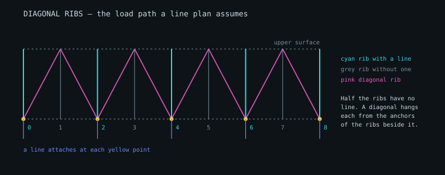

# Diagonal ribs

Chapter 7 of the handbook is figures and one paragraph, so this is a
reconstruction from the drawings, from what the geometry has to do, and from
the complete designs in the repository — the Swoop2 above all, which states
its own.

> "Diagonal ribs (V-rib) are used primarily to reduce the number of anchors
> in the sail ... joining the intrados surface with the extrados surface of
> adjacent ribs." — handbook, 7.1

---

## 1. Why they exist

Every line attachment is a point of drag and a point of load, so modern wings
attach lines to every second or third rib rather than to all of them.

**The ribs with no line on them still carry lift**, and it has to reach the
lineset somehow. A diagonal rib is what carries it: a triangular gusset from
the anchor on a rib that has a line, across the cell, to a run of the upper
seam of the rib beside it that has none.

Without them, a wing whose lines attach every second rib has half its span
hanging on nothing. With the diagonals turned off the tool now says so — the
status line counts the ribs "with no load path" — where it used to report no
problem at all.



*Cyan ribs carry a line; grey ribs do not. Each pink triangle runs from an
attachment point on a loaded rib up to the upper seam of its unloaded
neighbour. Generated from the tool's own geometry by `tools/make-diagrams.mjs`.*

---

## 2. Where they go: where the lines are

A diagonal hangs from a line. So where they go is the line plan's to say, row
by row: `planAnchorRibs` reads the ribs each row's lines actually attach to,
and `buildVRibs` takes them as `anchorRibsByRow`.

**The interface did not do this.** It built the diagonals before the plan
existed and gave them every second rib, whatever plan was then drawn. That is
the default plan and no other:

- a written cascade spreads each row's anchors at its own spacing;
- the Swoop2 attaches on ribs 2-3, 6-7, 10-11 … of its 26 — and was drawn
  with 50 invented diagonals a side, 22 of them hanging from ribs that carry
  no line at all;
- "Diagonal reach" could not do anything, because by construction every free
  rib had a lined one beside it. `tools/dead-controls.cjs` found it.

Rows are the designer's choice ("Diagonals on rows"); the default is every row
that has lines. It was B and C only, which left the A anchors — the most
loaded row — spreading nothing to the ribs between them.

### A design that states its own

LEP section 12 gives the Swoop2 39 diagonals a side, and the tool places those
(`parseHVRibs`, `lepDiagonalPieces`, then `buildVRibs` with `placed`): which
rib, which row, which neighbour. See section 9 for what is and is not read.

The rule, given the Swoop2's own lines, reproduces **37 of its 39** — all
thirteen on row A, twelve of thirteen on B and on C. The two it misses are at
the tip, where the designer hangs a B and a C diagonal from a rib that carries
only an A line. That is the test of the rule.

---

## 3. The flat pattern is exact

A diagonal is a fan: one apex, and a base curve on the neighbouring rib's
edge. That is a cone, and **a cone is developable** — it flattens with no
distortion, unlike the wing's own panels.

```
cos(dφ) = (r_k² + r_k₊₁² − s²) / (2 · r_k · r_k₊₁)
```

Every radius and every base segment comes out exact: the worst error on a real
diagonal is of the order of 10⁻¹⁵ m (`fanDevelopmentError`), and the
flat-pattern area equals the surface area to the same precision.

**Every stitch is on a seam.** The apex is a point on the lower seam of the
rib with the line; the base is a run of the upper seam of the rib it holds.
Two gussets from one anchor, to the ribs either side, are the V: one bottom
seam to two top seams. (A section here used to say the base landed "in the
middle of a panel". It never did, and a test now holds every base point to
the neighbouring rib's own edge. `buildSeamDiagonals` gives the same V as two
straight legs, for when a length is wanted rather than a pattern.)

---

## 4. Half the load travels diagonally

Every unloaded rib's lift must reach an attachment point, and the diagonals
are the only route. With lines on every second rib, **half the half-wing's
load travels diagonally** (`vribLoads`). That number is a check, not an
output: anything other than 50% means load is being lost or counted twice.

### The trade-off

Fewer attachments means less line drag, paid for in fabric and seam load. On
a 25-rib half wing, rows B and C, base 18% of chord:

| lines every | reach | lined ribs | diagonals | fabric | via diagonals | peak seam | left with |
| --- | --- | --- | --- | --- | --- | --- | --- |
| 1 rib | — | 25 | 0 | 0 | 0% | — | — |
| 2 ribs | 1 cell | 13 | 96 | 6.22 m² | 50% | 1.7 daN/m | nothing |
| 3 ribs | 1 cell | 9 | 64 | 4.15 m² | 67% | 3.3 daN/m | 16 straps wanted |
| 4 ribs | 1 cell | 7 | 48 | 3.11 m² | 50%, a quarter with no path | 3.3 daN/m | **6 ribs unsupported** |
| 3 ribs | 2 cells | 9 | 128 | 10.52 m² | 67% | 2.2 daN/m | nothing |
| 4 ribs | 2 cells | 7 | 96 | 7.89 m² | 75% | 3.3 daN/m | 24 held from one side |

Every fourth rib with single-cell diagonals looks cheapest and is not
buildable: a one-cell diagonal cannot reach the middle of a three-cell gap.
`unsupportedRibs` names the ribs, and the status line counts them.

---

## 5. Held from both sides, or a strap

A diagonal pulls the rib it holds **down and sideways** — towards its anchor.
Two of them, one from each side, cancel sideways. One on its own does not: the
rib is drawn towards the anchor, and the cell beside it is pulled wide unless
something across the top holds it back.

`diagonalBalance` finds the ribs held from one side only, and pairs those that
face each other:

- lines on every second rib: every free rib is held from both sides;
- lines on pairs of ribs with two free between (the Swoop2): each free rib is
  held from one side, and a **strap across the top** between the two carries
  each pull against the other.

On the Swoop2 the statics wants 15 straps — five pairs of ribs, three rows —
and **the file states 15 pieces between exactly those pairs** (4-5, 8-9,
12-13, 16-17, 20-21 in its numbering). Neither reading was fitted to the
other. The tool reports them; it does not yet draw or cut them (section 9).

---

## 6. What loads a diagonal

The rib it **holds**. A rib with no line is lifted by the air on the panels
either side, and the diagonal sewn along its upper seam is what stops it
rising. The load enters along the base, acting the way that rib's lift acts —
along the rib, lower seam to upper — and leaves at the apex.

Two earlier versions had this wrong:

- **Along the diagonal's own axis.** By construction every fibre came out
  aligned. A check whose load is defined by the thing it checks finds nothing.
- **Along the line, towards the riser.** Nearer, and for an arc whose ribs
  point roughly at the pilot it gives much the same answer — but it is the
  wrong force. The line reacts what the diagonal brings to the anchor; it does
  not load it. Taken per anchor, a diagonal on the side its line leans towards
  read as slack when it carries its neighbour's lift like any other.

`buildVRibs` records the held rib's direction on each piece (`liftDirection`)
and `diagonalTension` uses it. Cloth can only pull, so a fibre works when it
opposes the load; on a diagonal that rises from a lower seam to an upper one
every fibre does. What varies is how well each is aimed.

| base width | area each | aimed (1 = straight back) | of its best fibre | pull that is sideways |
| --- | --- | --- | --- | --- |
| 8% of chord | 0.047 m² | 0.61 | 99% | 0.79 |
| 18% | 0.107 m² | 0.59 | 96% | 0.79 |
| 30% | 0.179 m² | 0.56 | 92% | 0.80 |
| 45% | 0.273 m² | 0.52 | 84% | 0.80 |

A wider base spreads into fabric further from the best direction: nearly six
times the cloth at 45% for a piece that is aimed 15% worse. That is the cost
of spreading the load along more of the rib, and it is a trade.

**What does improve the aim is narrower cells**, which rise more steeply for
the same reach:

| cells | rise in the cell | aimed | pull that is sideways |
| --- | --- | --- | --- |
| 20 | 31° | 0.53 | 0.84 |
| 40 | 50° | 0.74 | 0.63 |
| 60 | 61° | 0.83 | 0.48 |

A designer whose diagonals are poorly aimed should add cells, not adjust the
base.

---

## 7. Are they buildable?

`diagonalGeometry` flags a piece that is too short to sew, too long to
support, too shallow to carry load up into the upper surface, or lopsided
against its opposite number. The Structure view marks those apexes in red.

**Rise is measured in the piece's own cell** (`riseDeg`): from the cell's
floor, the lower surface running to the neighbouring rib's lower seam. It was
measured from the horizon, and the arc tilts a cell near the tip by fifty or
sixty degrees — by that measure 28 of the default wing's 96 diagonals a side
lie flat, for no reason but where on the arc they are. In their cells they
rise 28° to 57°, the rear row least.

Sizes follow the cells. On the default wing, 24 cells a side:

| row | pieces a side | length | rise in the cell |
| --- | --- | --- | --- |
| A | 24 | 243–390 mm | 33–50° |
| B | 24 | 247–465 mm | 46–57° |
| C | 24 | 202–414 mm | 43–53° |
| D | 24 | 174–307 mm | 28–35° |

All 96 are a sensible size and angle, and every rib they hold is held from
both sides. The two legs from one rib differ as the cells either side do, by
a few per cent: 629 against 618 mm at rib 2 of a 12-cell test wing, 464
against 425 mm at rib 10. On that coarser wing the four inboard pieces of row
B are over 600 mm and are flagged as too long to hold their shape — a wing
with half-metre cells wants more cells, not longer diagonals.

`minLengthM` ("Skip diagonals shorter than") leaves out the small ones. On the
default wing:

| limit | placed a side | skipped | sizes | left with |
| --- | --- | --- | --- | --- |
| 0 | 96 | 0 | 174–465 mm | nothing |
| 200 mm | 93 | 3 | 202–465 mm | 1 rib held from one side |
| 250 mm | 83 | 13 | 250–465 mm | 3 held from one side |
| 350 mm | 42 | 54 | 351–465 mm | **2 ribs unsupported** |

It defaults to 0: turning it on changes a design without being asked, and
pushed far enough it leaves ribs with nothing holding them, which
`unsupportedRibs` reports.

### What this document used to say

That the outboard leg "collapses towards the tip" — 675 mm one way and 75 mm
the other from the same rib, a 9 to 1 spread — because "a rib on an arc is
tilted, so its thickness has a spanwise component". Three sections explained
it and a fourth blamed sweep.

**It was the canopy being built inside out.** Each section was tilted the
wrong way about its chord, so the upper surface lay inside the arc; one leg
gained the offset and the other lost it. With the placement corrected the
asymmetry went, and so did the slack fibres and the "4.3 to 1" legs recorded
as properties of diagonals. They were properties of the bug.

---

## 8. Cutting them, and in the interface

`vribsToDXF` nests the diagonals and writes R12, apart from the sail: 48
gussets take 6.72 m of a 1.4 m roll at 33%. The bill of materials lists them
in the rib cloth, by count, area and mass.

The **Rib** tab and the rib pattern file carry both marks a builder needs: an
X where a diagonal hangs from this rib (`B>1,3` in the file: row B, to ribs 1
and 3, counted from 0 at the centre), and the run along which one is sewn on
(`B<0,2`). The **Structure** tab draws them
from the front, one row at a time if asked, with a stub of the line each hangs
from. What they come to — how many, the cloth, whether each is in tension,
buildable and held from both sides — is in the Internal structure panel, and
is re-evaluated on every rebuild.

---

## 9. LEP section 12, read and cut

The Swoop2's section 12 holds 124 pieces of three kinds, each with its own
row layout (`parseHVRibs`):

| type | count | what it is | here |
| --- | --- | --- | --- |
| 11 | 70 | a strap from an anchor row on one rib to the same row on the next | cut |
| 15 | 39 | a diagonal from an anchor, to the rib before or after | **placed**, and cut |
| 16 | 15 | a piece between two ribs at a chord position | cut |

**Left is towards the centre.** That is not from a manual; it is what the
file's own lines say. Read that way all 39 diagonals run from a rib with a
line to a rib with none. Read the other way, every one of them would join two
lined ribs — the one place a diagonal is never wanted.

The numbers this section once kept as written — the four that close a
type-15 row, those after each position on a type-16 row, the unit of a
type-11 width — are now read from the program's own source, and every piece
is cut as the design's program cuts it, to its cutting file's area
(`lepStructure`, `docs/internal-structure.md`). Thirty-nine rows are thirteen
pieces: a full diagonal is one piece per rib and side over all its rows.

What this document describes is the tool's model of a diagonal, and that is
what the drawing and the tension and balance figures still work on, placed at
the file's rows at the tool's base width. The bill and the Diagonals DXF of
an imported design carry its own pieces.

The gnuC2-23 has no full diagonals: its section 12 holds 18 V-ribs as
separate strips (type 3), placed as diagonals, and 93 pieces between two
ribs, of which the 27 that run from an anchor on one rib's lower surface to
the next rib above it are placed as diagonals too. Its other 66 join ribs
the model does not see, and the summary says that what it finds is on the
places it models (`docs/gnuc2-23.md`).

---

## 10. Not covered

- **Straps.** Wanted ones are counted (section 5); none is built, except an
  imported design's own (section 9).
- **Diagonals as structure.** They are load paths and cut patterns, not
  members with stiffness.
- **The effect on the rib itself.** A diagonal pulls on the rib it lands on;
  the rib cut is unchanged here.
- **Collisions between internal parts.** A diagonal's base and a nose rod can
  want the same run of the same seam, and nothing checks it. `checkRibInternals`
  does this for holes, ports and tabs.
- **Seam allowance on the gussets.** The diagonal file is finished outlines.
