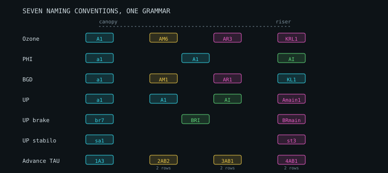

# Line plans, main lines and rigging

What three production line sets taught, and how the module was shaped by them.

Reference data: complete suspension line details for the **Geo 7** (5 sizes),
**Lyght** (5 sizes) and **UltraLite 5** (7 sizes) — 17 sheets, each a full
production cut list with a cascade totals matrix, exported from OzoneCAD.
Converted to TSV under `data/reference/`.

---

## 0. A riser is not a line

The PMA standard is explicit, and this project had it wrong for a long time:

> **Riser** — textile element between the main lines and the suspension point
> on the harness.
>
> **Main lines** — lines which are attached directly to the riser connectors.

So the three line levels are **upper**, **middle** and **main**. The riser is
webbing below all of them, and `docs/inspection.md` covers it. Anything below
that says "riser" means the webbing; the deepest *line* level is `main`.

## 1. Rows and risers are not the same thing

This is the finding that reshaped the module.

The handbook builds one cascade per anchor row. Every one of these wings has
**more anchor rows than risers**:

| Wing | Anchor rows | Risers | Cascaded |
| --- | --- | --- | --- |
| Geo 7 | A B C D | A B C | D into the C riser |
| Lyght | A B C | A B | C into the B riser |
| UltraLite 5 | A B C D | A B C | D into the C riser |

Assuming one riser per row gets the riser count wrong, the load split wrong,
and produces a wing that cannot be rigged. So a plan holds a list of risers,
each naming the rows it carries, and only the row that *owns* a riser gets
main-level lines — a cascaded row continues in `M` numbering and joins the
same maillon.

---

## 2. The naming grammar

Consistent across all three manufacturers' diagrams:

```
<ROW><LEVEL><INDEX><variant>          A1   AM3   AR2   KMU4   CRL4   A1a
```

| Part | Meaning |
| --- | --- |
| `A B C D E` | load-bearing rows, front to back |
| `K` | brakes |
| `Z` | collapse / stabilo lines (Lyght) |
| *(no level)* | upper line — attaches to the canopy |
| `M` | middle cascade |
| `R` | main level — attaches to the riser maillon |
| `MU`/`ML`, `RU`/`RL` | a level split upper/lower, e.g. a brake through a pulley |
| index | numbered from the wing centre outward |

UP Paragliders uses a **fourth level** and names two of them rather than
suffixing:

| form | level | example |
| --- | --- | --- |
| lowercase | top line, to the canopy | `a1` |
| uppercase | middle | `A1` |
| roman numeral | upper-main | `AI`, `CVI` |
| `main` + index | riser | `Amain1`, `BRmain` |

Roman numerals have to be read before digits: `AI` and `A1` are different
lines on the same wing. And two-letter rows need matching explicitly — a
greedy `[A-Za-z]{1,2}` takes `AI` out of `AIII`, fails the row check and
returns, silently discarding every numeral above II.

### Advance inverts it: the level is a prefix

The TAU DLS puts the level first and allows a row to be a **pair**:

| name | level | rows | reading |
| --- | --- | --- | --- |
| `1A3` | 1, at the canopy | A | third A line |
| `2AB2` | 2 | A **and** B | one line carrying both rows |
| `3CD1` | 3 | C **and** D | one line carrying both |
| `4AB1` | 4, at the riser | A and B | |

Two consequences.

**A prefix level is relative.** `3CD1` is a *riser* line on a three-level wing
and a *middle* line on a four-level one, so it cannot be resolved from the name
alone. Parsing records `depthFromCanopy`, and `resolveCascadeLevels` maps it
once the whole set is known.

**A combined row is not a naming quirk.** `2AB2` carries the A and B rows
together — **70% of the load** against the 35% a single-row reading gives.
Undersizing by a factor of two is the kind of error a naming convention should
not be able to cause, so `combinedRowShare` sums the rows a line actually
serves. Merging is how a cascade cuts line count without cutting anchor count,
and it is why a merged line is the thickest at its level.

## 3. Generating a plan

How closely a generated plan matches a real one, and what governs it.

### Validated against real line tables

Every reference sheet lists a **K row** alongside A/B/C/D. A generated plan
without brakes cannot be compared with one, and understates the wing by about
a fifth — so the brake cascade goes into the same plan.

With it, a three-liner lands within a line or two of the real table:

| wing | real | modelled | risers real / modelled |
| --- | --- | --- | --- |
| Ozone Geo 7 MS | 112 | **111** | 13 / 13 |
| Ozone Swift 6 MS | 114 | **115** | 13 / 13 |
| Ozone Alpina 5 ML | 118 | 110 | 10 / 16 |
| Ozone Zeno 2 ML | 102 | 91 | 7 / 14 |

The level split matches too — Geo 7 is 65 upper / 33 middle / 13 riser against
a real 68 / 31 / 13.

### Main lines are a fixed count, not a scaled one

A real wing has the **same number of main lines in every size**. The Geo 7
carries A:3 B:3 C:5 in XS, MS and L alike; the Alpina 5 carries A:4 B:4 in
every size; the Zeno 2 carries A:3 B:4.

The generator grouped by a constant chunk size, so its main count grew with
the anchor count — 16 against a real 10 on the Alpina, 19 against 7 on the
Zeno. `mainsPerRow` fixes the count instead, which is what a maker actually
specifies, and the mains then land exactly:

| wing | real mains | modelled |
| --- | --- | --- |
| Geo 7 MS | 13 | **13** |
| Swift 6 MS | 13 | **13** |
| Alpina 5 ML | 10 | 13 |
| Zeno 2 ML | 7 | 6 |

It defaults to null, keeping the old behaviour, because a design that has not
said how many mains it wants should not silently be given three.

### What is still wrong: attachment density

With the mains fixed, the two-liners' remaining error is in the **upper**
lines, and measuring the real wings says why:

| wing | ribs per half | uppers per row | spacing |
| --- | --- | --- | --- |
| Geo 7 MS | 25 | 14.3 | every 1.75 ribs |
| Swift 6 MS | 27 | 12.5 | every 2.16 ribs |
| Alpina 5 ML | 34 | 20.7 | every 1.65 ribs |
| Zeno 2 ML | 40 | 26.0 | every 1.54 ribs |

Broken down per row, the pattern is not "the front row is densest" — the
Geo 7 has C:15 against A:14. It is about **riser count**:

| wing | risers | per-row uppers | front-to-rear ratio |
| --- | --- | --- | --- |
| Geo 7 MS | 3 | A:14 B:14 C:15 D:14 | 0.9 |
| Swift 6 MS | 3 | A:17 B:17 C:8 D:8 | 2.1 |
| Alpina 5 ML | 2 | A:31 B:19 C:12 | 2.6 |
| Zeno 2 ML | 2 | A:30 B:14 C:8 | 3.8 |

**The fewer risers, the more the front row must carry the shape on its own.**
A three-liner spreads its rows nearly uniformly; a two-liner attaches the A
row at almost every rib and thins out sharply toward the trailing edge.

`anchorsPerRow` takes a count per row and spreads that many anchors evenly
across the half-wing, which reaches the fractional spacings an integer stride
cannot. Given the real per-row counts, the generator reproduces the real line
tables:

| wing | real | modelled | error |
| --- | --- | --- | --- |
| Geo 7 MS | 112 | 115 | +3% |
| Swift 6 MS | 114 | 107 | −6% |
| Alpina 5 ML | 118 | 119 | +1% |
| Zeno 2 ML | 102 | **102** | 0% |

**Worst error across four wings: 6%, down from 37%.**

`everyNthRib` still works and is still the default, because a design that has
not specified per-row densities should not be given someone else's.

### Deriving the densities: six designs, not thirty-three

There are 33 size sheets **in the six Ozone families this analysis uses** —
the database as a whole holds 63 — and treating them as 33 observations would
be wrong. **The line topology is identical across every
size in a family** — the Alpina 5 runs A:31 B:19 C:12 in XS through XL, the
Ultralite 5 A:16 B:16 C:16 D:16 in all seven sizes. Only the lengths scale.

So the evidence is **six designs**, and six points do not support a
two-parameter fit. The numbers are carried as grouped ranges instead:

| risers | designs | front-to-rear ratio |
| --- | --- | --- |
| 2 | Alpina 5, Lyght, Zeno 2 | 2.58 – 3.75 |
| 3 | Geo 7, Swift 6, Ultralite 5 | 1.00 – 2.13 |

The ranges do not overlap, but they nearly touch at 2.13 against 2.58 — so
this separates the two classes and would not settle a marginal case.

### Three shapes, because the designs show three

A single ratio was the first attempt. It fitted the two-liners at 6–8% and
missed the three-liners by up to **24%**, because they are not tapered at all:

```
Alpina 5     31 19 12      taper — each row carries less
Zeno 2       30 14  8      taper
Geo 7        14 14 15 14   flat
Ultralite 5  16 16 16 16   flat
Swift 6      17 17  8  8   step at the midpoint
```

A two-liner **tapers**: the A row holds the shape and each row behind carries
less. A three-liner is **flat**, or **steps** once — its C row still reaches
the riser, so the front does not have to do the work. Forcing one curve
through all three is the kind of fit that looks reasonable and is wrong on
half the sample. With the right shape, every design lands within 16%.

**Absolute density is an input, not a prediction.** Two three-liners in the
sample attach 56% and 89% of their ribs. Nothing here predicts that; it is a
choice about how much shape the sail holds by itself.

**Two-liners do not match, and the main count says why.** A real two-liner
cascades its C row into B and ends with far fewer main lines than the
generator produces: 10 against 16 on the Alpina, 7 against 14 on the Zeno.
The total is short while the risers are long, which points at the cascade
shape rather than the anchor count. Both are asserted, so the gap is recorded
rather than averaged into a pass.

### A regression it caused

Putting brakes in the plan made them arrive at the load model as **anchors**.
They took a share of the span load alongside A/B/C/D, and the closure error —
which asserts that anchor loads sum to half the wing's weight — went from
0.02% to **19.7%**.

Brakes carry pilot input, not lift. They are now excluded from the lift
distribution while still being sized as lines, and a test asserts that adding
them changes the closure error and the total load carried by *nothing at all*.

That check existed for exactly this. A plan that looked more realistic had
quietly broken the load model, and nothing else would have shown it.

### Generating a merged cascade

`buildLinePlan` takes `mergeRows: [['A','B'],['C','D']]`. Each row keeps its
own top lines — they attach at different chord positions and cannot be shared
— and everything below joins.

| | lines | total length | Cx lines |
| --- | --- | --- | --- |
| unmerged | 76 | 271 m | 0.0070 |
| A+B merged | 69 | 215 m | 0.0052 |
| A+B and C+D | 62 | 159 m | **0.0040** |

A 43% cut in line drag, which is why makers do it, paid for in thicker merged
lines and a cascade that is harder to trim.

**The merged cascade must keep the same number of levels.** Collapsing middle
and riser into a single line was the first attempt here: line count fell, and
every top line then had to span most of the way to the maillon, so total
length rose by a quarter and drag with it. The junctions have to stay where
they were; only their ownership changes.

Combined rows also occur in suffix form — the K2 5 carries `DE1`–`DE4`, which
went unrecognised until this. The guard that makes it safe is that both
letters must be load-bearing rows: there is no R row, so `BR1` falls through
and reads correctly as the B row's first main line rather than a combined
B-and-R line.



*The same cascade, canopy to riser, as five manufacturers write it. Colour is
the level the parser resolves, not the text.*
| `a`/`b` | a further split of one line (Lyght A-row) |

---

## 4. The stabilo, and why naming does not find it

The stabilo is the outermost line group. It holds the tip against folding
under, and it is what a pilot pulls for big ears. Every reference wing has
one, and **it cannot be identified by name on most of them:**

| maker | how the stabilo appears |
| --- | --- |
| UP Paragliders | `sa1` `sb1` `st1` — explicit, an s-prefix |
| Skywalk SAGE | `a17` `a18` `b17` `b18` — named as A and B, grouped in the sheet under "SAB", with the main `as4` colour-coded orange |
| Ozone | no marking at all; simply the highest indices in each row |

A parser looking for an S row finds the stabilo on **one manufacturer in
three**. So `findStabilo` tries the name first, and falls back to finding it
structurally.

### The signal is the gap

A wing's ordinary anchors are spaced fairly evenly. The stabilo sits past a
noticeably larger step, because the tip cells between it and the last ordinary
anchor are carried by it rather than by lines of their own. The typical
spacing is *measured* from the wing rather than assumed, and anything beyond
`gapFactor` times it is outboard:

```
0 3 6 9 12 15 18 21 24    even spread     -> no separate stabilo
0 3 6 9 12 15 18    24    one past a gap  -> 1 stabilo line
0 3 6 9 12 15    23 24    a pair          -> 2
0 2 4 6 8 10 12  22 23    dense inboard   -> 2, typical spacing 2 ribs
```

The first case matters as much as the others: a wing with no separate stabilo
is reported as having none, with a note saying so, rather than the outermost
ordinary anchors being silently relabelled.

### Generating a stabilo

`addStabilo` runs it to its own main line, as every reference wing does — the
SAGE puts it on the A2 riser, UP gives it `st` mains of its own.

It carries handling load, not lift, so like the brakes it is excluded from the
span-load distribution. A test asserts that adding a stabilo changes the
closure error by **nothing at all** — the same guard that caught the brake
regression.

## 5. Not yet modelled

- **Collapse lines** (`Z` row on the Lyght) — parsed, not generated. The
  stabilo is now generated; the collapse row is not.
- **Left/right asymmetry.** Quantities of 2 and 4 encode mirror pairs;
  asymmetric colour or line plans are not represented.
- **Brake free travel from geometry.** The cascade is generated and the
  coupling to the speed system is modelled, but how much slack a brake carries
  at rest still has to be supplied rather than derived.

---

---

## 6. Reading real line sheets

Recovering topology, riser length and junction positions from a
manufacturer's published numbers is covered in `docs/line-sheets.md`.

---

## 7. Writing a cascade down

The generator derives a cascade from rules: an anchor count per row, then a
branching factor. That is fine for exploring and wrong for **describing** — a
designer copying a real wing, or specifying one for a builder, knows the shape
they want and could not say it.

The format is how every manufacturer sheet in this project reads: row,
anchors, then the count at each level below.

```
# the Ozone Zeno 2, from its own plan
A 30 14 3
B 14  6 4
C  8  3 2
```

`parseCascadeSpec` reads it, `buildLinePlan` builds exactly that, and
`cascadeSpecFor` writes a built plan back out so one can be edited and reused.
It is a checkbox and a text box in the tool, under Lines & risers.

### What it refuses

A spec is typed by a person, so the typos a person makes are caught rather
than built: a row name that does not exist, a level with **more** lines than
the one above it, a zero or negative count, a row given twice, and rows
reaching different depths.

`/^[A-Z]{1,2}$/` accepted `QQ` as a row. Two letters is legitimate — `BR`
and `ST` are rows — so the test has to be against the known set, not against
the shape.

### Two defects it exposed

**`mainsPerRow` said per row and was one integer applied to all of them.** A
spec asking for A:3 B:4 C:2 could not be built; the A row came back with
seven. Real plans differ by row — the Zeno 2's own is A:3 B:4 — which one
number cannot express.

**`chunkInto` returned one group fewer than asked, whenever the division was
inexact.** Six middles into four came back as **three**, because
`ceil(6/4) = 2` and three chunks of two exhaust the array a group early. The
shortfall check did not fire because it compared against the same wrong
arithmetic.

Sizes are distributed now — the first `length % groups` chunks take one extra
— and an empty input returns nothing rather than one empty group, which was a
regression the first fix introduced and which produced NaN line lengths
several steps away.
