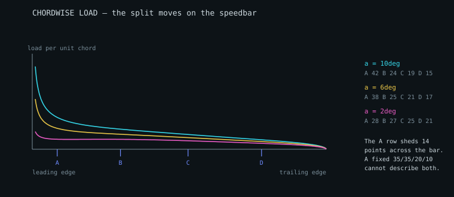
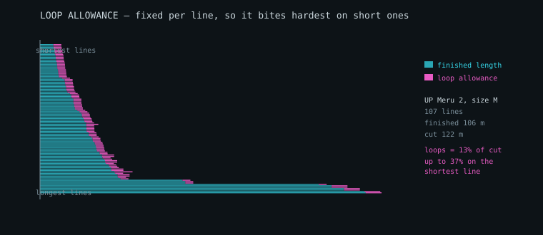

# Loads, line materials and drag

Phase 2's keystone: turning lift into load, load into line tension, and
tension into a line thick enough to hold it. Several roadmap items depended on
this one.

Reference data: the **PHI ALLEGRO X-alps 21** line sheet and PHI's measured
line materials table (78 line types), plus the ALLEGRO light size table across
six sizes. Under `data/reference/`.

---

## 1. The chain

```
lifting-line spanwise lift
  -> load per rib          (lift over the span each rib owns)
  -> load per anchor       (split between rows by chordwise share)
  -> tension per line      (a line carries everything above it)
  -> line selection        (smallest line whose kinked strength clears it)
  -> stretch correction    (cut short so it flies to length)
  -> line drag             (diameter x length -> Cx, back into the balance)
```

Only step 3 is exact. Steps 1 and 2 are models, and step 4 depends on a
materials table. Those are stated at the top of the module rather than buried.

**Load case.** EN 926-1 load-tests a paraglider to 8g, so that is the design
case, with a further factor on each line — 1.5 on main lines, 2.0 on brakes,
which see shock loading.

---

## 2. The correction the PHI data forced: kinked strength

The measured table carries **two** breaking loads per line:

| | new | kinked | loss |
| --- | --- | --- | --- |
| Edelrid 8000-135 (U-135) | 160 daN | 85.6 daN | **47%** |
| Liros TSL 140 | 140 daN | 67.6 daN | **52%** |
| Liros PPSLS 260 | 280 daN | 259.4 daN | 7% |

A line in service is not straight. It is knotted or spliced at every loop,
bent round every maillon and pulley, and creased in the bag. Sizing on the new
figure under-sizes by nearly a factor of two on exactly the lines a designer is
most tempted to make thin.

**Selection therefore uses the kinked strength by default.** `strengthBasis:
'new'` exists for comparison and should not be used to build anything.

### What the loss belongs to

The fibre, not the sheath. The 8000-U lines (the U-135) are aramid, TSL is
aramid under a polyester cover, PPSLS and DC are Dyneema with and without one:

| kinked | fibre | sheathed | keeps | daN per mm² |
| --- | --- | --- | --- | --- |
| DC40 | Dyneema | no | 86% | **209** |
| PPSLS 180 | Dyneema | yes | 97% | 158 |
| U-135 | aramid | no | 53% | 90 |
| TSL 140 | aramid | yes | 48% | 48 |

The catalogue's 48 aramid lines keep 38 to 70% kinked, its 26 Dyneema lines
59 to 114%. Per square millimetre bare Dyneema carries the most and a
sheathed aramid the least, the cover being diameter, and drag, that carries
nothing — which is what the reference wing does: bare Dyneema in the thin,
numerous top lines, aramid in the middle, sheathed Dyneema on the handled mains.

(This ranked lines per mm of *diameter*, "sheathed Liros beat unsheathed
Dyneema", with the aramid U-135 for Dyneema: a ranking of sizes, not fibres.)

---

## 3. Line drag, and closing a Phase 1 loop

`cxLines` has been a typed-in constant since Phase 1, defaulting to the
handbook's 0.020. It need not be. A line is a bluff cylinder: drag area is
diameter times length times a coefficient near 1.1, adjusted for inclination
to the flow by `sin^2(psi)` — the independence principle for yawed cylinders —
and divided by wing area.

Computed for a modern thin lineset it comes out near **0.006-0.010**, roughly
a third of the handbook's figure, which came from a 2012 school wing with more
and thicker line. Since line drag is a large share of a paraglider's total,
the difference is not academic:

| | glide ratio | line share of drag |
| --- | --- | --- |
| assumed 0.020 | 8.48 | 27.7% |
| computed 0.0055 | **10.62** | 9.6% |

(The test wing, 46 lines a side.)

That is most of why modern wings glide better than the handbook's example.
`equilibriumInputsFrom` hands the computed drag and the lineset's own mass
straight back to `solveEquilibrium`.

---

## 4. Two bugs the closure check caught

The load model asserts that anchor loads sum to **half** the wing's load,
because a plan describes one side. Two failures showed up immediately, and
neither would have been visible in the output:

**Ribs double-counted.** Assigning each anchor the load of a fixed window of
ribs around it counts twice every rib that two anchors share, inflating the
total by 50%. Fixed by assigning each rib to its single nearest attachment
point, which partitions the span exactly once.

**A whole row's load vanished.** Riser tension was summed over lines at
`riser` level. But a cascaded row — D on a three-riser wing — reaches the
maillon while still numbered as middle lines, so the D row's load never
reached a riser. Fixed by summing what meets each maillon, not what is
labelled.

Two more, found later. With **rows merged**, a shared line carried only the
first row's load: an A+B main took 73 N of its 146, and under A+B and C+D the
risers held 55% of the pilot. And with **different anchor counts per row**,
loads were keyed by anchor number, so 13 top lines of an A19 B11 C6 plan
carried nothing and up to 13% of the weight was lost. Tension is summed down
each anchor's own path now, keyed by its own line. Closure is to the step of
the span integration: 0.024% at worst over the 55 published sizes.

---

## 5. Trim is the wrong sizing case

Everything above sizes each line for the load it carries in **trimmed**
flight. That is the wrong case, and the chordwise pressure work shows why: the
load distribution moves a long way on the speedbar, so the split between the
rows at speed is not the split at trim.

Swept across the bar on a wing with 180 mm of travel:

| bar | α | A | B | C | D |
| --- | --- | --- | --- | --- | --- |
| 0% | 6.00° | 37.9 | 24.8 | 20.6 | 16.8 |
| 25% | 3.85° | 33.6 | 25.5 | 22.2 | 18.6 |
| 50% | 1.71° | 26.3 | 26.8 | 25.0 | 21.8 |
| 63% | 0.65° | 20.3 | 27.9 | 27.3 | 24.4 |



*Load per unit chord from thin-aerofoil theory, at 10, 6 and 2 degrees. The
wing is strongly front-loaded at high incidence and much flatter at low, which
is why the split between the rows is not the same at trim and at speed.*

The rear rows gain steadily as the front row sheds load. Worst tension over
the flyable range, against trim: **A +0%, B +13%, C +39%, D +46%**.

The consequence is concrete. **54 of 73 lines are governed by a bar position
other than trim**, and three of them need a thicker line than trim-only sizing
would choose.

`loadEnvelope` sweeps the bar and sizes each line for the worst case it sees
anywhere in the flyable range.

### Two things it has to get right

**Total load does not change.** In steady flight the lines carry the weight
whatever the speed; only the distribution moves. An envelope reporting rising
*total* load would be wrong, so the shares are checked to still sum to one at
every bar position.

**The sweep must stop where the wing stops flying.** Run to the end of the bar
the angle of attack drops below the collapse floor, and thin-aerofoil theory
reports the A row carrying **negative** load — the front of the section
pushing down. That is not a modelling error. It is the frontal-collapse
mechanism, and the A lines going slack is its precursor. But it is not a load
case either, because the wing is no longer flying. Those positions are
excluded from sizing and reported with a reason.

### A subtlety that produced a wrong test first

Comparing trim sizing against envelope sizing must hold the **share model**
fixed. Sizing at trim with the handbook convention and on the envelope with
pressure-derived shares conflates two changes, and the convention's larger B
share then makes the envelope appear to need *less* line there — which says
nothing about the speedbar. Both sides use the same share model, so what is
measured is the effect of the bar alone.

---

## 6. Gust loads, and why the case is 8g

Steady flight explains the distribution but not the magnitude. A vertical gust
changes the angle of attack by roughly `w/V`, and the lift that produces
scales with dynamic pressure:

```
Δn = ρ · V · a · w / (2 · W/S)
```

For a 25 m² wing at 95 kg with a 7.5 m/s gust:

| condition | load factor |
| --- | --- |
| trim, 10.3 m/s | **7.40 g** |
| full speed, 16.1 m/s | **11.00 g** |

A strong gust at trim lands close to the **8 g** the EN 926-1 load test uses,
which is a useful cross-check on both. At speed the same gust exceeds it —
which is why a wing is certified to a factor it will not see in calm air, and
why the speed range is where line strength earns its keep. This is the
sharp-edged form; section 12 adds the alleviation, which changes the answer.

---

## 7. Cut length is not finished length

Every maker in the reference set quotes one number per line and leaves the
loop allowance implicit. **UP Paragliders breaks it out**, and their sheets
carry three columns where the others carry one:

```
line | length | | loop length | cutting length | material | colour
a1   |   295  | |         130 |            425 | DC 120   | Red
```

`cutting length = length + loop length`, and the allowance is **a constant
for each kind of line, not a fraction of its length**. On the Meru 2 it is
130 mm on every canopy and middle line, whether 220 mm long or 1.2 m, 200 mm
on the upper mains, 260 mm on the mains and 300 mm on the brake main.



*Every line on a Meru 2 size M, shortest at the top. The magenta band is the
loop allowance: much the same width on every bar, so it is a sliver of a main
line and a third of a top line.*

The consequence, on their own numbers: 108 m of finished line in 108 lines
becomes **124 m of material**, +15%. Loops are **13% of everything cut**, and
**38% of the shortest line**. (These were the L's, under the M's name.)

`stretchCorrection` now takes `loopAllowanceMM` and reports finished length
and cut length separately. A model that returns only one of them is either
under-ordering material or over-cutting lines.

### A sheet that disagrees with itself

Of 24 component sheets, 23 satisfy their own arithmetic exactly. One — the
Meru 2 M folding lines — has cutting lengths about 3% short of length plus
loop. It was filed as the SM's: the converter wrote each sheet of UP's .xls
workbooks under the next sheet's name. Under its own, the cause is plain —
all twenty-two of its cutting lengths are the SM sheet's, to the millimetre.

It is reported rather than absorbed. A checking tool that quietly accepts a
sheet inconsistent with itself is not checking anything.

---

## 8. The PHI line sheet: a third format

Where the Ozone sheets are an inventory with a totals matrix alongside, this
is a **cascade table** — one row per canopy attachment, with each level's
length across the columns and the total in a "Checking" column.

```
Rib | upper | middle | riser | ... | Checking
  2 |  1344 |   1779 |  4255 |     |     7378
  5 |  1247 |        |       |     |     7281
```

A blank means "shared with the row above", and the **name** columns say which
line that is — `a1|A1|AI` then `a2|A1|AI`. A third naming convention again:
lowercase for upper lines, uppercase for middle, roman numerals for riser.

Reading the columns positionally, carrying the last value forward, cannot tell
a shared line from a level that simply does not exist for that anchor, and gets
both wrong at the tip. Keying on names gets it right.

**The arithmetic closes exactly** — level lengths sum to the printed total with
no residue, unlike the Ozone sheets where riser length had to be inferred. All
42 main-row anchors close to the millimetre, which makes this the strongest
check on cascade totals anywhere in the project.

### Cross-row cascades, confirmed from a second manufacturer

The checker resolves deficits against other blocks, and recovers the same
structure the Ozone wings showed:

- **D inherits `C1 + CI` from the C row** — four anchor rows on three risers,
  D cascading into C.
- **B and C tip lines inherit `AIII` from the A row** — at the tip the rows
  merge onto a shared main line.

Three manufacturers, three formats, same underlying arrangement.

---

## 9. Not decoded

The **brake block** is parsed structurally but flagged rather than guessed at.
Brakes run a deeper cascade and list each upper line twice — once plain and
once with the spanwise distribution added, offset by exactly the `A-dist`
column — so the level columns do not line up one-to-one with the names.
Decoding it needs the brake and pulley geometry, and is not done.

---

## 10. Wake shielding between lines

A line sitting in the wake of one ahead of it sees reduced dynamic pressure
and makes less drag. Whether that matters on a paraglider is a question of
scale, and the scale is unintuitive.

**The rows are separated by a chord fraction, which for a 1 mm line is
hundreds of diameters.** A wake that far downstream has both decayed and
spread — at 600 diameters it is about 6 mm wide.

So the test is not "is there a line ahead of it" but **"is this line inside
that wake"**. Those give very different answers:

| criterion | lines shielded |
| --- | --- |
| any line within 50 mm laterally, ahead | 34 of 46 |
| inside the wake, half-width `0.25·√(x·d)` | **14 of 46** |

The first is how a small effect gets reported as a large one, and both are
asserted so the distinction cannot quietly collapse.

With the width taken properly: mean deficit 5.0%, worst 9.7%. Drag goes as
velocity **squared**, so a 9.7% deficit is an 18% reduction on that one line —
and across the wing:

```
Cx lines   0.00540 -> 0.00513    -5.0%
glide      10.64   -> 10.69      +0.05
```

Real, small, and now measured rather than either ignored or assumed large.

It is **off by default**. The wake model is first-order — a single upstream
shielder, no wake merging, no unsteadiness — and a 5% correction from a
first-order model should be offered, not imposed.

---

## 11. Where the load goes on the bar

The roadmap carried this as an open item: *"loads shift forward on the bar,
changing what each row carries; loads.js still assumes trim."*

**Both halves were wrong.** `rowShareMode: 'pressure'` has derived the shares
from the section since Phase 2 — a capability I nearly reimplemented before
checking — and the shift is **aft**, not forward:

| alpha | A | B | C | D |
| --- | --- | --- | --- | --- |
| 12° (slow) | 43.8% | 23.7% | 18.3% | 14.2% |
| 6° (trim) | 37.9% | 24.8% | 20.6% | 16.8% |
| 2° (bar) | 27.6% | 26.6% | 24.5% | 21.3% |

Taking the bar lowers the angle of attack, the centre of pressure moves aft,
and the rear rows take more. The A row **sheds 27% of its share** between trim
and full bar while D gains a quarter.

That is why rear-riser steering works accelerated and why the C and D lines
have to be sized for the bar rather than for trim. In anchor loads on the test
wing: A falls 177 → 129 N while D rises 78 → 99 N.

Now asserted, including that the shares sum to one at every angle.

---

## 12. Gust alleviation, and why a paraglider has so much of it

The gust model was **sharp-edged**: the wing meets the full gust velocity
instantly. It does not. The wing accelerates upward as the gust builds, so it
sees less change in angle of attack than the sharp-edged case assumes.

The standard treatment is the Pratt-Walker factor from CS-23 and FAR-23:

```
mu = 2 (W/S) / (rho c a g)          mass ratio
Kg = 0.88 mu / (5.3 + mu)           alleviation factor
```

The mass ratio is where a paraglider is unusual — it scales with wing loading,
and a paraglider's is about 3.5 kg/m² against 60 or more for a light aircraft:

| aircraft | W/S (N/m²) | mu | Kg | sharp | alleviated |
| --- | --- | --- | --- | --- | --- |
| paraglider | 34 | 0.67 | 0.098 | 11.13 | **2.00** |
| hang glider | 70 | 1.06 | 0.147 | 5.92 | 1.72 |
| microlight | 250 | 5.94 | 0.465 | 2.38 | 1.64 |
| light aircraft | 700 | 15.53 | 0.656 | 1.49 | 1.32 |

**A paraglider is heavily alleviated because it is so lightly loaded** — a
wing that cannot resist being pushed up sees very little angle-of-attack
change. The factor here is **10.2x**.

### What it changes

The sharp-edged figure of 11.13 **exceeds the 8 g certification case**, which
would say gusts govern the design. Alleviated, it is 2.00 — well under. So the
8 g case is not gust-driven. Nor is it collapse-driven: half the span folded
in level flight, with a dynamic factor of 1.5, works the lines that are left
2.5 times as hard as level flight does (`docs/load-cases.md` §2).

That is where a large part of the conservatism in the 8 g case comes from, and
it is worth knowing rather than assuming the margin is spent on gusts.

### The caveat that has to travel with it

Pratt and Walker fitted this to **aeroplanes**, with mass ratios from about 5
to 100. A paraglider comes out near **0.67** — an order of magnitude below
anything in the original data.

The formula behaves sensibly there (Kg falls smoothly toward zero, which is
physically right for a wing that gets pushed up rather than flying through the
gust), but it is an extrapolation. The result carries
`extrapolatedBelowFitRange: true` and says so in its note, and both are
asserted. **Nothing in this project validates it below mu = 5.**

Given no mean chord, the sharp-edged result is returned unchanged and marked
as such, rather than an alleviation being invented from defaults.

### Checking the extrapolation from first principles

There is no data here to validate Pratt-Walker at mu = 0.67. There is,
however, an equation of motion with nothing empirical in it:

```
m z'' = ½ρVSa (w − z')
```

The wing sees the gust velocity minus its own upward velocity. It accelerates
up, which reduces what it sees, which reduces the acceleration. **That
feedback is the alleviation** — no fitted constants involved. Integrating it
for a 1-cosine gust gives an independent answer:

| mu | Kg (Pratt-Walker) | Kg (integrated) | difference |
| --- | --- | --- | --- |
| 0.39 | 0.061 | 0.049 | −19.1% |
| **0.67** (paraglider) | 0.098 | 0.083 | **−16.0%** |
| 2.50 | 0.282 | 0.271 | −3.9% |
| **5.94** | 0.465 | 0.480 | **+3.3%** |
| 18.72 | 0.686 | 0.749 | +9.2% |

**They agree to 3% at mu ≈ 6 — inside the fitted range — which is the check
that the integration itself is sound.** Outside it they diverge, and the
direction is what matters: at paraglider mass ratios the integration gives
*less* alleviation, so **Pratt-Walker predicts more load. Using it there is
conservative by 19%.**

That does not validate the extrapolation, but it bounds it, and it bounds it
on the safe side.

**The caveat on the caveat:** the integration is *quasi-steady* — lift is
taken to follow angle of attack instantly, where the Küssner function
describes the lag as circulation builds. It declares `quasiSteady: true`. So
where the two agree, both are probably right; where they diverge, only the
direction should be trusted.

One assertion of mine was backwards here: I wrote "a longer gust gradient
alleviates more" expecting a *bigger* factor. A longer gradient gives the wing
more time to accelerate away, so it alleviates more and the factor is
**smaller** — 0.026 over 40 chords against 0.194 over 5.

---

## 13. Choosing what to build from

`DEFAULT_LINE_TABLE` carries 21 lines. `data/reference/line-materials.tsv`
has **78 across four brands** — Edelrid 38, Liros 24, DC 12, Cousin 4 — and it
has been in the repository, parsed by the corpus sweep, and unreachable when
the model needed to choose one.

A line table is a design decision. A workshop buys from one supplier, or has a
spool of something specific, and the sizing should work from what is on the
shelf rather than from a fixed list.

### The choice is not cosmetic

Restricting the table changes which line is chosen at every anchor, and so the
drag, the mass and the bill of materials:

| table | lines available | sized | line drag |
| --- | --- | --- | --- |
| every brand | 78 | 46/46 | **0.00485** |
| DC | 12 | 46/46 | 0.00490 |
| Edelrid | 38 | 46/46 | 0.00592 |
| Liros | 24 | 46/46 | 0.00610 |
| Cousin | 4 | **43/46** | 0.00410, of the 43 |

Buying from one supplier costs **from 1% to 26% more line drag** on the test
wing, depending on the supplier, because the sizing has fewer diameters to
choose from and must round up more often. And a catalogue of four materials
**cannot size every line** — reported rather than left as three lines quietly
missing from the bill.

### In the tool

The whole catalogue is embedded in the offline file, and the brand picker sits
under Assumptions with the sizing basis — kinked strength or new — beside it.
The choice is verified to change an exported file, not just the screen.
