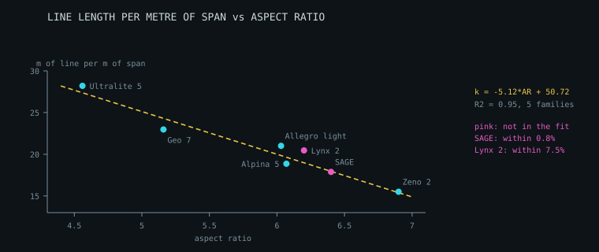

# Size families and scaling

Manufacturers ship a wing in five or six sizes. This is what the measured data
says about how a family is related, where the obvious assumption fails, and
where this document's own first answers failed.

Reference data: `data/reference/size-families.tsv` — seven families from four
makers, 38 sizes — with PHI's own table for the **ALLEGRO light**
(`phi-allegro-light-sizes.tsv`), and the line sheets of five of the seven
families, size by size.

---

## 1. What is scaled, and what is not

### The canopy is

PHI's six sizes, each figure as a power of the span ratio:

| quantity | exponent | |
| --- | --- | --- |
| flat area | 2.00 | scaled |
| projected area | 1.99 | scaled |
| maximum chord | 1.01 | scaled |
| minimum chord | 0.97 | scaled |
| **aspect ratio** | — | **constant at 6.03**, spread 0.009 across all six |

One shape, scaled: chord distribution, arc and washin all carry over, and a
single factor `k = sqrt(areaRatio)` is all that is needed. The flat area goes
as the square of the span in every one of the seven families (1.99 to 2.03).

### So is the height of the lines

| family | what is measured | how it goes with the wing |
| --- | --- | --- |
| Ozone Geo 7 | 57 line paths a size, canopy to the bottom of the riser | within **0.3%** of scale at all five sizes |
| Ozone Ultralite 5 | 64 paths a size | within **0.5%** from the 17 to the 25 |
| PHI Allegro light | the line length PHI publish | 0.6025 × span to **5 mm**, S to XL |
| Skywalk SAGE | the line length without risers | 0.6244 × span to **6 mm**, all five |
| BGD Lynx 2 | the line height BGD publish | the scale factor BGD state, to its rounding |

And where a size is off that, it is a size the maker made differently:

- the **Ultralite 5's 13 and 15** hang 5% shorter than scale, on mains a
  tenth shorter — the two smallest sizes of a mountain wing, and the two most
  heavily loaded wings in the set
- **PHI's XS** is 98 mm longer than the other five would make it

No law fitted across a family finds a decision made for one size of it.

### The riser is not

It is hardware, and it comes in one or two lengths:

| family | riser |
| --- | --- |
| Ozone Geo 7 | 527 mm on four sizes, 472 mm on the XS (by the sheets' own sums) |
| Ozone Ultralite 5 | 525 to 530 mm from the 17 up, 514 mm on the 13 and 15 |
| PHI Allegro light | 570 mm on the XS and S, 600 mm on the rest |
| Skywalk SAGE | 520 mm on the two smallest, 540 mm on the rest |

Ozone say so on the Enzo 3's check sheet: *"Reference Line Length of
Self-Certified sizes must stay within ±20 mm of the scaled XXS Reference Line
Length. Risers are not scaled."* On their own numbers the worst line is 8.8 mm
from scale and the mean 2.6 mm. Speed-system travel steps the same way — 150
and 180 mm on PHI's.

### So the lines grow faster than the wing

The height is scaled and a piece of it is not, so the rest has to grow by
more. On the Geo 7 the mains and the middle lines are scaled, to 0.3%, and the
top lines take all of it:

| size | scale | height | riser | mains | middle | top lines |
| --- | --- | --- | --- | --- | --- | --- |
| XS | 0.928 | 0.925 | 472 mm | 0.928 | 0.928 | 0.929 |
| S | 0.966 | 0.969 | 527 | 0.969 | 0.969 | **0.933** |
| MS | 1 | 1 | 527 | 1 | 1 | 1 |
| ML | 1.029 | 1.031 | 528 | 1.031 | 1.031 | **1.067** |
| L | 1.060 | 1.062 | 527 | 1.062 | 1.062 | **1.135** |

A top line on the MS is 482 mm on average. Scaled to the L it would be 511 mm;
add what the riser did not grow by, 6% of 527 mm, and it is 543 mm. Ozone cut
547. (The XS has its own shorter riser, and every level of it is scaled.)

The Ultralite 5 does the same from the 17 up: top lines 0.904, 1, 1.085, 1.173
and 1.266 of the 19's, where the wing is 0.946, 1, 1.049, 1.098 and 1.152.

Top lines are half the pieces in a lineset — 114 of 224 on the Geo 7 — so the
**cord** runs ahead of the span:

| family | cord goes as span to the | |
| --- | --- | --- |
| Ozone Ultralite 5 | 1.30 | top lines take the riser's share |
| Ozone Geo 7 | 1.15 | top lines take the riser's share |
| BGD Lynx 2 | 1.08 | |
| Ozone Alpina 5 | 1.06 | every level within 1.4% of scale |
| Skywalk SAGE | 1.05 | |
| Ozone Zeno 2 | 1.04 | every level within 0.8% of scale |
| PHI Allegro light | 1.02 | |

Over 1 in all seven. `familyLineScaling` makes the measurement from a
family's sheets; the suite runs it on Ozone's four.

### And the mass has a fixed part

Mass against projected area is a straight line with a positive intercept in
every family: 0.3 to 1.1 kg that is there at any size.

---

## 2. What this section used to say

> Line length is `0.566 × span + 0.459 m`, R² 0.995: **affine, not
> proportional**. Lines are set partly by pilot geometry and handling rather
> than by wing size. Scaling a design isometrically therefore gives lines that
> are slightly too long on the big sizes and too short on the small ones.

The fit is what PHI's six figures give. Its reading was wrong three ways.

**The fixed part is one size.** Leave the XS out and it is −0.02 m: none. Five
sizes of six lie on a line through the origin, and the sixth is the XS, 98 mm
over. `splitFixedAndScaling` now fits with each size left out in turn and says
when a fixed part rests on one of them. Its first version drew its line
through the first size — the XS — found 0.945 m, and the suite recorded that
as "the riser".

**A power law fits as well.** "A power law lands 1.6% out where the affine
fit is within 0.6%" holds only with the exponent fixed at 1 from the XS.
Fitted, it is 0.93 and within 0.63% — against 0.66% for the affine law. Six
sizes over 18% of span cannot tell the two forms apart.

**The direction was backwards.** Scale every line of a lineset and keep the
riser, and the big sizes come out too *short*: section 1. The total line
length has a *negative* intercept in all seven families.

---

## 3. The fitted laws are for interpolating

`fitScalingFamily` fits a straight line to each figure of a measured family,
and inside the family they are close: within 0.7% on PHI's line length, and
within 2% on the total and the mass in all seven.

Fitted to PHI's three smallest sizes and used on the three largest:

| | line length | | total line | | mass | |
| --- | --- | --- | --- | --- | --- | --- |
| | fitted | scaled | fitted | scaled | fitted | scaled |
| ML | 0.63% | 1.47% | 1.00% | 0.60% | 2.49% | 0.56% |
| L | 1.08% | 1.42% | 1.16% | 0.63% | 3.76% | 0.19% |
| XL | **1.83%** | 1.40% | 1.52% | 0.60% | **5.89%** | 1.42% |

The fitted law's error grows with every size beyond the fit, and plain scaling
does not. For the mass and the total it is the worse of the two at once; for
the line length, by the third size out. (Scaling is 1.4% out at every size
here because it starts from the XS.)

So `scaleToArea` checks whether the target is inside the fitted range and
scales isometrically outside it. It scales isometrically, too, whenever it is
given no laws — which is what the interface does.

A figure a table does not give is left out of its fit. It used to go in as
zero: a family with no line length column fitted `0 × span + 0` at R² = 1, and
scaling it gave a wing with lines 0 m long "by the affine law".

---

## 4. Wing loading is a decision, not a law

A family is not one wing in several sizes. PHI's, at the middle of each
certified weight range:

| size | projected area | mid weight | loading |
| --- | --- | --- | --- |
| XS | 17.49 m² | 62.5 kg | 3.57 kg/m² |
| S | 18.91 | 75.0 | 3.97 |
| M | 20.40 | 85.0 | 4.17 |
| ML | 21.40 | 93.0 | 4.35 |
| L | 22.44 | 100.0 | 4.46 |
| XL | 24.48 | 117.5 | **4.80** |

Loading rises 34% from the smallest size to the largest. Each of the six
mainstream families is loaded harder at its largest size than its smallest, by
11 to 34%, and the mountain wing runs the other way — 6.4 kg/m² on its 13,
4.5 on its 25. Anything that assumes constant loading across a family (a
polar, a speed, a load case) needs the size's own figure.

Between families, loading rises with aspect ratio: 3.87 kg/m² for the Geo 7 at
5.16 to 4.95 for the Zeno 2 at 6.9, r = +0.92 over the six mainstream
families. `LOADING_VS_AR` is that line. It places a family to 5% and a single
size no closer than 17%, for the reason above. The mountain wing is left out
of it by design: the Ultralite 5's 13 flies at 6.4 kg/m² on the lowest aspect
ratio in the set, and with it in, r is +0.11.

(This was "r = +0.99, one of the cleanest trends in this whole dataset" — on
three families, with the Zeno 2 entered as 4.85.)

---

## 5. The coefficients do not transfer

Total line length against span, and mass against projected area:

| family | line slope | intercept | R² | mass slope | intercept | R² |
| --- | --- | --- | --- | --- | --- | --- |
| PHI Allegro light | 21.46 | −5.54 | 0.983 | 0.159 | +0.29 | 0.987 |
| Ozone Geo 7 | 26.54 | −40.93 | 0.991 | 0.127 | +0.96 | 0.974 |
| Ozone Ultralite 5 | 36.64 | −76.93 | 0.997 | 0.093 | +0.39 | 0.999 |
| Ozone Zeno 2 | 16.23 | −9.20 | 0.997 | 0.206 | +1.04 | 0.999 |
| Ozone Alpina 5 | 20.08 | −14.41 | 1.000 | 0.148 | +1.09 | 0.999 |
| BGD Lynx 2 | 21.96 | −18.02 | 0.999 | 0.173 | +0.33 | 1.000 |
| Skywalk SAGE | 18.83 | −11.37 | 1.000 | 0.137 | +1.13 | 0.997 |

Every fit is tight, and the slopes differ by a factor of 2.3. They depend on
how many lines a wing carries, how deep its cascade runs and how it is built.
Borrowing one family's laws for another lands 9.7 to 46% out among the first
three — worse than assuming nothing.

So `scaleToArea` scales isometrically unless handed laws fitted to the family
being scaled, and says which it used. `EXAMPLE_SCALING` is PHI's fit, kept as
a worked example. `crossFamilyError` measures the borrowing.

---

## 6. Driving a whole family through the pipeline

`buildFamily` runs geometry, panels, nesting, balance, line plan, loads and
line selection for every size, so a family produces cutting files and line
schedules rather than a table of dimensions.

**The canopy scales; the lineset does not.** Every planform length multiplies
by k, so a family shares one shape and the aspect ratio is identical to machine
precision. But line *loads* scale with k², following weight, while a line's
strength scales with its cross-section — so each size is sized from its own
loads.

### The Ozone Geo 7 family, built

At its published spans and mid weights, with the lines and the riser of each
size taken from its own sheet — the centre A line, and the riser its sums
imply (16 cells and 58 lines a side, floor 0.50 mm):

| size | flat area | span | all-up | lines | riser | speed | glide | fabric | line mass | load-sized |
| --- | --- | --- | --- | --- | --- | --- | --- | --- | --- | --- |
| XS | 22.64 m² | 10.69 m | 63 kg | 5.97 m | 472 mm | 31.7 km/h | 11.12 | 25.0 m | 47 g | 10/58 |
| S | 24.58 | 11.14 | 75 | 6.21 | 527 | 33.4 | 11.09 | 28.3 | 57 | 12/58 |
| MS | 26.32 | 11.52 | 85 | 6.42 | 527 | 34.3 | 11.09 | 31.3 | 66 | 12/58 |
| ML | 27.85 | 11.85 | 95 | 6.64 | 528 | 35.3 | 11.09 | 30.5 | 72 | 16/58 |
| L | 29.58 | 12.22 | 105 | 6.85 | 527 | 36.0 | 11.08 | 31.6 | 81 | 18/58 |

(The suite prints this table, as "the family table". It had 60 lines a side
and line masses a fifth higher before the rear row stopped having mains of
its own and the sheathed lines were weighed at their makers' figures.)

Areas run 2% above the published figures because the planform is parametric
rather than the real Geo 7 shape; span is set directly. The glide is this
tool's, for that planform and a NACA 4415, and not a claim about the Geo 7.

Two things were wrong with this table before it was checked against the
sheets. The line lengths were `6.6 m × k^0.85` — lines growing more slowly
than the wing, which is section 2's mistake again. And each size's trim was
solved with its pilot a riser's length higher than its own line plan hung
him: the balance was given the lines, the plan the lines and the riser.

### Three results

**The load-sized fraction rises with size** — 17% on the smallest to 31% on
the largest. Loads scale with k² while the floor does not move, so a small
wing's lines are decided almost entirely by handling and a large wing's
increasingly by load.

**Line mass per square metre rises** — 2.1 to 2.7 g/m² — though the canopy is
geometrically similar, because bigger wings need thicker line.

**Line drag does not improve with size.** Cx of the lines is 0.00483 on the
smallest size and 0.00504 on the largest, across a 31% increase in area — 4%
the other way.
The floor caps it: a small wing is already on the thinnest line there is, and
a large wing's lines are thicker.

**Roll length is not smooth.** The ML takes less cloth off the roll than the
MS: it packs to 71% and the MS to 66%. The cloth *in* a square metre of wing
is the same at every size; what the roll gives up is how whole panels happen
to fit beside each other.

---

## 7. Application: comparisons must be like for like

Comparing a hike-and-fly wing with a competition wing and calling the
difference a scaling failure is a category error. These wings are built to
different briefs, and almost every ratio that looks like a law tracks the
brief. At the middle size of each:

| wing | application | cert | AR | cells/m span | line m/m² | kg/m² | loading |
| --- | --- | --- | --- | --- | --- | --- | --- |
| Ozone Ultralite 5 | hike and fly | A/B | 4.56 | 3.66 | **13.8** | **0.102** | 4.55 |
| Ozone Geo 7 | progression | B | 5.16 | 4.17 | 10.2 | 0.142 | 3.90 |
| PHI Allegro light | performance XC | C | 6.03 | 5.86 | 10.3 | 0.148 | 4.35 |
| Ozone Alpina 5 | performance XC | C | 6.07 | 5.35 | 9.4 | 0.170 | 4.59 |
| BGD Lynx 2 | performance XC | C | 6.20 | 5.51 | 10.5 | 0.161 | 4.36 |
| Skywalk SAGE | performance XC | C | 6.40 | 5.66 | 9.5 | 0.167 | 4.39 |
| Ozone Zeno 2 | competition | D | 6.90 | 6.05 | **8.3** | **0.217** | 5.05 |

Read as design decisions rather than as quality:

- **Line length per m² falls 40%** from the mountain wing to the competition
  wing. Line drag is a first-order cost to a wing whose job is glide, so it
  carries fewer and thinner lines. The mountain wing also carries more per m²
  simply because it is small: line goes with span and area with its square.
- **Cells per metre of span rise by two thirds.** More, narrower cells hold a
  cleaner profile; they also cost weight and build time.
- **Mass per m² doubles**, in the reverse of the performance order. The
  Ultralite 5 is the lightest per m² because that is its reason for existing.
- **A low aspect ratio is not a worse wing.** It is the right answer to a
  launch in a col with a pack on your back.

`classifyApplication` infers the class from aspect ratio and certification,
`compareApplications` flags a cross-class comparison and says what differs
rather than ranking, and `compareFamilies` reports these metrics.

---

## 8. The line-length law that transfers



*Seven families from four manufacturers. The dashed line is fitted to the five
in blue; the two in pink were not in the fit.*

The slope of total line length against span follows aspect ratio (r = −0.96)
and follows span (r = −0.98), and the two follow each other (r = +0.91): a
higher aspect ratio means a longer span at the same area. Five families
separate them. Geo 7 and Allegro light have mean spans 5% apart; the Allegro's
aspect ratio is 17% higher and it carries **9% less line per metre of span**.
Holding span fixed, the slope still follows aspect ratio at r = −0.86.

Normalising by span leaves a quantity that survives leaving its own family:

```
line metres per metre of span  =  -5.12 x AR + 50.72        R² = 0.95
```

| wing | AR | risers | actual | fitted |
| --- | --- | --- | --- | --- |
| Ozone Ultralite 5 | 4.56 | 3 | 28.2 | 27.4 |
| Ozone Geo 7 | 5.16 | 3 | 23.0 | 24.3 |
| PHI Allegro light | 6.03 | 3 | 21.0 | 19.8 |
| Ozone Alpina 5 | 6.07 | 2 | 18.9 | 19.6 |
| Ozone Zeno 2 | 6.90 | 2 | 15.5 | 15.4 |

("Actual" is the mean over a family's sizes.) From **aspect ratio and span
alone**, with nothing fitted to the family, total line length lands within
**6.2%** at the middle size of each of the five and within **7.4%** at every
one of their 28 sizes. Two makers — four of the five are Ozone's — two- and
three-line wings, and more than 2:1 in area.

### Out of sample

| family | sizes | the law is |
| --- | --- | --- |
| Skywalk SAGE | 5 | within **0.8%** at every size |
| BGD Lynx 2 | 4 | **6.6 to 7.5% under** at every size |

The Lynx 2 is a 2.5-liner — three rows in the middle, two at the tips — and
carries more line than the law gives its aspect ratio, by the same amount at
every size. A level, not a slope.

### Riser count: proposed, tested, withdrawn

Allegro light and Alpina 5 have the same aspect ratio (6.03 and 6.07) and
span, and the Alpina, a two-liner, carries 10% less line per metre. That
became a two-liner factor of 0.90. The SAGE is a two-liner at 6.4 that was not
in the fit: the uncorrected law is within 0.8% of it, and the factor would put
it 9% low. `twoLinerFactor` is 1; the 0.90 is kept beside it as refuted. Over
the three two-liners here the mean residual is −1.2%, over the three
three-liners +1.1%.

### Caveats kept with the law

- Five families is a small sample for two parameters, and one maker's wings
  are four of them.
- It gives a level. To carry a *measured* size to its neighbours, use the
  family's own exponent from section 1 (`lineLengthExponent`,
  `lineConsumptionEstimate`): from the Ultralite 5's 19 that is within 2.1%
  across the range, where an exponent of 1 is 5.5% out.

---

## 9. BGD's published total is not its lineset

This document said for some time that the law "broke" on the Lynx 2 — within
1% on the XS and **16% out on the L** — because "BGD scales its lineset with
area": exponent 2.03, "a manufacturer-level design decision", and an open
question in the roadmap as to why.

It was measured against the "Total line length" row of BGD's specification
table. BGD's production line sheets for four of the sizes were in
`data/reference` the whole time.

| size | stated factor | published total | m per m² | sum of the line sheet | ratio to M |
| --- | --- | --- | --- | --- | --- |
| XS | 0.92 | 209 m | 10.72 | — | — |
| S | 0.96 | 226 | 10.76 | 229.7 m | 0.951 |
| M | 1.00 | 247 | 10.74 | 241.6 | 1 |
| ML | 1.04 | 268 | 10.72 | 252.4 | 1.045 |
| L | 1.08 | 290 | 10.74 | 262.7 | 1.088 |

The published total is the same 10.7 m for every square metre at all five
sizes: the M's figure multiplied by the ratio of the areas. The sheets — the
same 121 lines a side at every size — go with the linear factor, at every
level of the cascade (1.086, 1.083 and 1.092 on the L, for 1.08). At the L the
table says 290 m and the lines add up to 262.7.

The table's next row should have been enough. BGD publish a line **height**,
6.7 to 7.9 m, and it goes with the factor: no lineset of a fixed number of
lines can go with area while its height goes with span.

`size-families.tsv` holds the sums of the sheets now, and
`published-specs.tsv` keeps the published row, because the two disagree.

### What BGD's factor does confirm

BGD state a **linear scaling factor** for each size, alone among these makers:

| size | stated | span | √area | chord | height |
| --- | --- | --- | --- | --- | --- |
| XS | 0.92 | 0.924 | 0.921 | 0.917 | 0.918 |
| S | 0.96 | 0.958 | 0.956 | 0.958 | 0.959 |
| ML | 1.04 | 1.042 | 1.043 | 1.042 | 1.041 |
| L | 1.08 | 1.085 | 1.083 | 1.083 | 1.082 |

All within 0.005, on figures quoted to two and three digits. A manufacturer
stating outright the scaling section 1 measures.

---

## 10. Measurement notes

**Aspect ratio from rounded figures.** Ozone state 4.56 for all seven
Ultralite 5 sizes; span and area quoted to one decimal compute anywhere from
4.51 to 4.60. That spread is rounding, and a fit that treats it as real
rejects a regular family. The maker's figure is used where there is one.

**Exponents from rounded figures.** Averaging `log(v_i/v_0) / log(s_i/s_0)`
over the sizes is the obvious estimator and behaves badly: consecutive sizes
are close, the ratios are small, and they carry the full rounding error. On
the Zeno 2 it returns **1.86** for an area plainly going as the square of
span. Least squares on log-log returns **1.99**, and is what the module uses.

**A blank cell is not a zero.** `Number('')` is 0. Every blank in the family
table used to be read as one — PHI's line pieces, which nobody has counted,
came back as none.

---

## 11. What this does not cover

- **Per-family fitting is required** for the affine laws. Seven families are
  measured and the coefficients do not transfer.
- **Cell count** is one figure a family in this table — 34 to 78. Some makers
  change it between sizes, which breaks the isometry of the panel work.
- **Which lines take up the riser** is read off two of Ozone's families. The
  sheets of the other two give no path lengths, and PHI's, BGD's and
  Skywalk's linesets are not held size by size or are not broken down here.
- **Line diameters** are not scaled. Each size is sized from its own loads,
  which is what `loads.js` does.
- **Niviuk** was imported later and tested against these laws out of sample:
  `docs/niviuk-import.md`.

---

## 12. Generating a family, from the interface

There is a **Size family** group — count, smallest and largest area, all-up
mass at each end — and a button that writes the table. The lines of each size
are the design's, scaled with the wing, on the design's own riser, unscaled.
(Section 1 says it is the height *with* the riser that a maker scales. On a
6.5 m lineset and a half-metre riser the two differ by 4 cm at a size 8%
larger.)

### Two things that had to be right first

**Line length is the line HEIGHT, not the total.** `lineLengthM` is the height
of the lines, canopy to riser top; `lineLengthPerSpan` gives total metres of
cord. Feeding one where the other belongs would have put 273 m where 6.5 m
goes on the default wing. Left null entirely, the table came out with **NaN speed and NaN glide on
every row** — a table that looked like a table and told nobody anything.

**A declared base area must match the base geometry.** Every size scales by
`sqrt(area / base.flatArea)`, so a base declared at 22.5 m² whose planform
measures 22.91 put every size **1.8% over what was asked for** — consistently,
quietly, and in the direction that makes a wing bigger than its label.

`buildFamily` measures the base and refuses a declaration that contradicts
it. But only when it matters: a size may give its scale factor `k` directly,
and then the base area is never read — which is how the Geo 7 family above is
built at published spans its approximated planform does not match.
