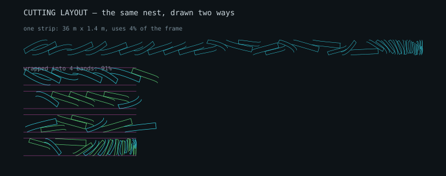

# Viewports: fitting, zooming, and the rib view

## 1. Two kinds of picture, opposite needs

A drawing and a chart want opposite things from the same frame, and getting it
backwards produces something correctly fitted and useless.

**Geometry** — plan, front view, section, rib pattern. Both axes are metres,
so the scale must be identical in x and y. Stretch one axis and the wing drawn
is not the wing.

**Charts** — the polar, the atmosphere plot. A drag polar has Cx on one axis
and Cz on the other: both dimensionless, measuring different things, with the
y range about twenty times the x range. There is no ratio between them to
preserve.

Applying the geometric rule to the polar honoured the aspect ratio of data
that had none. The result was a vertical line down the middle of a wide frame
using **1.6% of its width**, with empty space either side. Independent axes
make it **53× wider** and fill the frame.

`fitScales` in `src/core/viewfit.js` makes the decision, and it is in core
rather than the interface so it can be tested: the suite asserts both the
sliver and the fix, using the real polar's coordinate ranges.



*The same nest twice. Drawn as one strip it is a hairline using about 4% of
the frame; wrapped into bands the way a long roll is laid out on a floor, it
uses 91%. A display transform only — the DXF is byte-identical either way.*

## 2. Pan and zoom

The section-balance and rib views take wheel zoom about the cursor, drag to
pan, and double-click to reset. The default is always the fitted view, and a
badge appears once the view has been moved so it is obvious why a drawing is
no longer framed the way it started.

The transform is stored as a **viewBox**, not an SVG transform. With
`vector-effect: non-scaling-stroke` on every path that keeps line weights
constant as the view changes — zooming in reveals detail rather than
thickening every line, which is what a transform would do.

A view the user has moved survives a redraw. Someone who has zoomed into the
trailing edge to look at the calage should not lose it because a slider moved.

## 3. Tabs

Six viewports do not fit usefully in one grid, so they are grouped:

| tab | shows |
| --- | --- |
| **Wing** *(default)* | plan, front arc, section balance, cutting layout |
| **Rib** | one rib at a time, full frame, with a rib selector |
| **Analysis** | polar, atmosphere |

Only the visible tab is drawn. Hidden grids have no size, so anything drawn
into one fits to nothing — the redraw happens on the way in, not on the way
out.

## 4. The rib view

The wing views answer *what shape is this wing*. This one answers *what do I
cut for station 14*.

The rib is projected back into its own plane using the same transform as the
DXF rib export, so what is on screen is the pattern rather than a perspective
of it. Drawn with it:

- the section outline, and the seam allowance that is actually cut
- the air intake, on the lower surface where it belongs
- the line anchor points that pierce this rib, labelled by row
- the chord line, and leading and trailing edge markers

The caption carries what makes this rib different from its neighbours:
station, chord, thickness as a percentage, washin, dihedral, yaw, and the
flow-alignment angle φ. Stepping the selector across the span shows the chord
shrinking, the washin building and φ growing outboard — which is the wing's
twist distribution made visible one rib at a time.

---

## 5. Dimensions

A plan view without dimensions is a picture, not a drawing. A designer reading
one wants the span and the chords off the page rather than out of a settings
panel, and a reviewer wants to check the drawing agrees with the numbers
beside it.

**On the plan:** span, root chord, tip chord, and tip sweep.

**On the rib** — the drawing a builder actually marks out from:

- the chord along the datum
- maximum thickness, **at the station where it actually occurs**. A reflexed
  or heavily cambered section does not peak where a textbook one does, so the
  dimension finds the maximum rather than reading a nominal 30%.
- every anchor position, measured from the leading edge

They are drawn in model coordinates so they scale and rotate with the
geometry, with tick length in pixels so they stay legible at any zoom, and the
label turned the right way up rather than upside down on a return leg.

### Checked against the model, not just for existing

A drawing whose labels disagree with the design is **worse** than one with no
labels: a reviewer checks the drawing against the panel beside it, and a stale
number there is a number they will trust.

The interface test reads the rendered labels back and compares all ten
against the model — span, root and tip on the plan; projected span and
arrow on the front view; and chord plus four anchor positions on the rib.

The front view's two are measured off the arc **as plotted**, and the model
reports the same figures by a different route, so holding them to each
other checks both.
Verified in both directions by scaling a label by 10% and watching it fail:

```
FAIL anchor A is drawn at 218 mm, model says 198 mm
```

---

## 6. Colour was never checked

The diagonals view shades each fibre blue where the fabric carries load and
red where it does not. **It drew every fibre red for a whole release.**

Two things had to be wrong at once. The view called `checkDiagonalTension`
without a maillon, so the load direction fell back to the diagonal's own axis
— and once the sign was corrected, so that a fibre works by *opposing* the
pull rather than following it, that fallback meant nothing opposed anything.
8 of 240 fibres blue, against 160 with the real line direction.

No test could have caught it. The drawing was only ever checked by **element
count**, and the count was right: 3140 elements either way. The stub DOM's
`setAttribute` was an empty function, so every colour, width and dash the tool
drew was discarded before anything could look at it.

The stub records attributes now, and the interface test counts the two colours
and fails if nothing is drawn as carrying load. Verified by reverting the fix:

```
FAIL every diagonal fibre drew red (2880 of 2880);
     the load direction is not the line's
```

That is the fourth defect this project has had where the output looked
plausible and the check could not see it. The pattern each time is the same:
the test measured something adjacent to what mattered.

---

## 7. Light mode, and getting a drawing out

### Where the switch is

In the **masthead**, beside the wing name, labelled with what pressing it will
do rather than what is currently on.

It was a select at the bottom of the Planform panel, under six sliders about
leading-edge ellipticity — somewhere nobody would look for a colour scheme,
and it was reported as missing entirely. Appearance is not a design parameter
and does not belong among them.

### Two themes

The drawings are SVG with explicit `stroke` attributes, which a stylesheet
cannot reach — so a `[data-theme="light"]` block handles the page chrome and
the drawing colours are mapped in script.

Mapping happens at the single point where an attribute is set, not at the
hundred call sites that pass a colour. Editing those would mean getting one
wrong and not noticing.

The palette is the AutoCAD Color Index the handbook's DXF uses, warmed for a
dark screen. Those values glow on near-black and wash out on white, so light
mode darkens each towards **its own hue** rather than towards grey: a yellow
stays recognisably yellow at a readable contrast.

| dark | light |
| --- | --- |
| `#e8c547` | `#907a2c` |
| `#35d6e8` | `#218590` |
| `#ffffff` | `#11181d` |
| `#1a252c` (grid) | `#dfe6ea` |

A test asserts the two themes share **no** stroke colour, so a mapping that
stops being applied fails rather than leaving a dark wing on a white page.

### Saving a drawing

Every viewport carries **SVG** and **PNG** controls, added from script so a
new viewport gets them without anyone remembering.

SVG is the honest export: vector, the size the geometry is. PNG is what goes
into a document, rendered at three times screen size because a drawing
captured at screen size is unreadable when printed. Both paint the background
in, since a drawing with none renders on whatever the viewer uses.

### A table of every parameter

`Design parameters` writes every setting and every derived figure as one
table, each row marked `set` or `derived`. The JSON export is the design; this
is the design as a person reads it.

**View preferences are excluded.** The colour scheme, the open tab and the
rib on screen say nothing about the wing, and listing them invites a reader to
think they might.

It failed on the Swoop2 first time: it read `M.equilibrium`, which does not
exist, and `M.lengths.totalM`, which is not the field name — the real ones are
`flyingMetres`, `sewnMetres` and `cutMetres`, three different numbers a
builder needs separately. Caught because the Swoop2 is pushed through every
button.

---

## 8. The isometric view

Every other viewport is an orthographic projection down one axis, which is
what a cutting file needs and is not how anyone pictures a wing. The line
cascade especially: it collapses onto itself in plan, and in the front view it
is a fan of overlapping segments.

The isometric view rotates the geometry by azimuth and elevation and projects
it orthographically — no perspective, so lengths along a given direction stay
comparable and the view can still be measured off. Both halves are drawn, with
the leading and trailing edges picked out, and the cascade coloured by row at
**true positions**.

OpenGlider renders its wings in 3D through FreeCAD. This is the same idea in
the one file.

### The default elevation looked along the arc

It shipped looking wrong, and the reason is specific.

A paraglider's tips drop about **27 degrees** below its root. Set the camera's
elevation to that and it looks straight down the arc, which then projects to
nothing — the wing renders as a flat line and the cascade hangs off it at
angles that look impossible, because the thing they hang from has collapsed.

**The default was 25 degrees.** Within two of the degenerate angle for a
typical wing.

| elevation | arc visible on screen |
| --- | --- |
| 0° | 2.52 |
| 15° | 1.17 |
| **25°** | **0.22 — vanished** |
| 45° | 1.66 |

The default is 12° now, and the view says so when the slider is taken near the
degenerate angle:

> the arc runs at 28°, so this elevation looks along it and flattens the wing
> — move the slider

A test asserts the default keeps at least half the arc, and fails on the old
one: `the default elevation 25 looks along the 28 degree arc`.

### It is a picture, and that is the distinction

Line *width* here is free to be legible, because nothing about a drawing
claims to be a measurement. That is exactly why the 3D **export** may not do
the same thing with line *diameter*: a model whose dimensions are not the
design's is not a model of the design.

Wanting to see the cascade is a reason to draw a picture of it, not a reason
to falsify the model.
