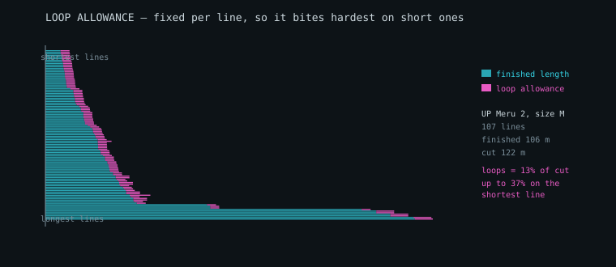

# Loads, line materials and drag

Phase 2's keystone: turning lift into load, load into line tension, and
tension into a line thick enough to hold it. Several roadmap items depended on
this one.

Reference data: the **PHI ALLEGRO X-alps 21** line sheet and PHI's measured
line materials table (78 line types), plus the ALLEGRO light size table across
six sizes. Under `data/reference/`.

---

## 1. The chain

```
lifting-line spanwise lift
  -> load per rib          (lift over the span each rib owns)
  -> load per anchor       (split between rows by chordwise share)
  -> tension per line      (a line carries everything above it)
  -> line selection        (smallest line whose kinked strength clears it)
  -> stretch correction    (cut short so it flies to length)
  -> line drag             (diameter x length -> Cx, back into the balance)
```

Only step 3 is exact. Steps 1 and 2 are models, and step 4 depends on a
materials table. Those are stated at the top of the module rather than buried.

**Load case.** EN 926-1 load-tests a paraglider to 8g, so that is the design
case, with a further factor on each line — 1.5 on main lines, 2.0 on brakes,
which see shock loading.

---

## 2. The correction the PHI data forced: kinked strength

The measured table carries **two** breaking loads per line:

| | new | kinked | loss |
| --- | --- | --- | --- |
| Edelrid 8000-135 (U-135) | 160 daN | 85.6 daN | **47%** |
| Liros TSL 140 | 140 daN | 67.6 daN | **52%** |
| Liros PPSLS 260 | 280 daN | 259.4 daN | 7% |

A line in service is not straight. It is knotted or spliced at every loop,
bent round every maillon and pulley, and creased in the bag. Sizing on the new
figure under-sizes by nearly a factor of two on exactly the lines a designer is
most tempted to make thin.

**Selection therefore uses the kinked strength by default.** `strengthBasis:
'new'` exists for comparison and should not be used to build anything.

### A consequence worth knowing

Ranked by kinked strength per millimetre of diameter — the figure of merit,
since drag goes with diameter:

| line | diameter | kinked | daN per mm |
| --- | --- | --- | --- |
| PPSLS 260 (sheathed) | 1.58 mm | 259.4 | **164** |
| PPSLS 180 (sheathed) | 1.25 mm | 194.4 | **156** |
| DC40 | 0.50 mm | 41.0 | 82 |
| U-135 (unsheathed) | 1.10 mm | 85.6 | 78 |
| U-050 (unsheathed) | 0.61 mm | 23.5 | 39 |

Sheathed Liros lines *beat* unsheathed Dyneema per millimetre once kinked,
because they barely lose strength when bent. On the new-strength figure the
ranking reverses. This is exactly what the reference wing does: PPSLS for the
long lower gallery where lines are thick anyway, thin DC and U lines for the
uppers where loads are small.

---

## 3. Line drag, and closing a Phase 1 loop

`cxLines` has been a typed-in constant since Phase 1, defaulting to the
handbook's 0.020. It need not be. A line is a bluff cylinder: drag area is
diameter times length times a coefficient near 1.1, adjusted for inclination
to the flow by `sin^2(psi)` — the independence principle for yawed cylinders —
and divided by wing area.

Computed for a modern thin lineset it comes out near **0.006-0.010**, roughly
a third of the handbook's figure, which came from a 2012 school wing with more
and thicker line. Since line drag is a large share of a paraglider's total,
the difference is not academic:

| | glide ratio | line share of drag |
| --- | --- | --- |
| assumed 0.020 | 9.37 | 28.7% |
| computed 0.0097 | **11.00** | 16.3% |

That is most of why modern wings glide better than the handbook's example.
`equilibriumInputsFrom` hands the computed drag and the lineset's own mass
straight back to `solveEquilibrium`.

---

## 4. Two bugs the closure check caught

The load model asserts that anchor loads sum to **half** the wing's load,
because a plan describes one side. Two failures showed up immediately, and
neither would have been visible in the output:

**Ribs double-counted.** Assigning each anchor the load of a fixed window of
ribs around it counts twice every rib that two anchors share, inflating the
total by 50%. Fixed by assigning each rib to its single nearest attachment
point, which partitions the span exactly once.

**A whole row's load vanished.** Riser tension was summed over lines at
`riser` level. But a cascaded row — D on a three-riser wing — reaches the
maillon while still numbered as middle lines, so the D row's load never
reached a riser. Fixed by summing what meets each maillon, not what is
labelled.

Closure is now exact to 0.01%.

---

## 5. Trim is the wrong sizing case

Everything above sizes each line for the load it carries in **trimmed**
flight. That is the wrong case, and the chordwise pressure work shows why: the
load distribution moves a long way on the speedbar, so the split between the
rows at speed is not the split at trim.

Swept across the bar on a wing with 180 mm of travel:

| bar | α | A | B | C | D |
| --- | --- | --- | --- | --- | --- |
| 0% | 6.00° | 38.0 | 24.7 | 20.5 | 16.8 |
| 25% | 3.81° | 33.6 | 25.5 | 22.2 | 18.7 |
| 50% | 1.62° | 26.1 | 26.8 | 25.1 | 22.1 |
| 63% | 0.5° | ~20 | ~28 | ~28 | ~25 |


*Load per unit chord from thin-aerofoil theory, at 10, 6 and 2 degrees. The
wing is strongly front-loaded at high incidence and much flatter at low, which
is why the split between the rows is not the same at trim and at speed.*

The rear rows gain steadily as the front row sheds load. Worst tension over
the flyable range, against trim: **A +0%, B +12%, C +33%, D +46%**.

The consequence is concrete. **78 of 104 lines are governed by a bar position
other than trim**, and six of them need a thicker line than trim-only sizing
would choose.

`loadEnvelope` sweeps the bar and sizes each line for the worst case it sees
anywhere in the flyable range.

### Two things it has to get right

**Total load does not change.** In steady flight the lines carry the weight
whatever the speed; only the distribution moves. An envelope reporting rising
*total* load would be wrong, so the shares are checked to still sum to one at
every bar position.

**The sweep must stop where the wing stops flying.** Run to the end of the bar
the angle of attack drops below the collapse floor, and thin-aerofoil theory
reports the A row carrying **negative** load — the front of the section
pushing down. That is not a modelling error. It is the frontal-collapse
mechanism, and the A lines going slack is its precursor. But it is not a load
case either, because the wing is no longer flying. Those positions are
excluded from sizing and reported with a reason.

### A subtlety that produced a wrong test first

Comparing trim sizing against envelope sizing must hold the **share model**
fixed. Sizing at trim with the handbook convention and on the envelope with
pressure-derived shares conflates two changes, and the convention's larger B
share then makes the envelope appear to need *less* line there — which says
nothing about the speedbar. Both sides use the same share model, so what is
measured is the effect of the bar alone.

---

## 6. Gust loads, and why the case is 8g

Steady flight explains the distribution but not the magnitude. A vertical gust
changes the angle of attack by roughly `w/V`, and the lift that produces
scales with dynamic pressure:

```
Δn = ρ · V · a · w / (2 · W/S)
```

For a 25 m² wing at 95 kg with a 7.5 m/s gust:

| condition | load factor |
| --- | --- |
| trim, 10.3 m/s | **7.40 g** |
| full speed, 16.1 m/s | **11.00 g** |

A strong gust at trim lands close to the **8 g** the EN 926-1 load test uses,
which is a useful cross-check on both. At speed the same gust exceeds it —
which is why a wing is certified to a factor it will not see in calm air, and
why the speed range is where line strength earns its keep.

This is the sharp-edged form, with no gust alleviation factor. That is
conservative, which is the right direction for a line that has to hold.

---

## 7. Cut length is not finished length

Every maker in the reference set quotes one number per line and leaves the
loop allowance implicit. **UP Paragliders breaks it out**, and their sheets
carry three columns where the others carry one:

```
line | length | | loop length | cutting length | material | colour
a1   |   295  | |         130 |            425 | DC 120   | Red
```

`cutting length = length + loop length`, and the allowance is **a constant per
wing, not a fraction of length** — 130 mm on the Meru 2 whether the line is
250 mm or 4 m long.



*Every line on a Meru 2 size M, shortest at the top. The magenta band is the
loop allowance: a fixed width on every bar, so it is a sliver of a main line
and a third of a top line.*

The consequence, on their own numbers: 106 m of finished line becomes **122 m
of material**, +15%. Loops are **13% of everything cut**, and **37% of the
shortest line**.

`stretchCorrection` now takes `loopAllowanceMM` and reports finished length
and cut length separately. A model that returns only one of them is either
under-ordering material or over-cutting lines.

### A sheet that disagrees with itself

Of 24 component sheets, 23 satisfy their own arithmetic exactly. One — the
Meru 2 SM folding lines — has cutting lengths about 3% short of length plus
loop, while the same wing's other sizes are exact. The ratio is not constant
(0.969 to 0.974), so it is not a clean rescale either, and the cause cannot be
determined from the data.

It is reported rather than absorbed. A checking tool that quietly accepts a
sheet inconsistent with itself is not checking anything.

---

## 8. The PHI line sheet: a third format

Where the Ozone sheets are an inventory with a totals matrix alongside, this
is a **cascade table** — one row per canopy attachment, with each level's
length across the columns and the total in a "Checking" column.

```
Rib | upper | middle | riser | ... | Checking
  2 |  1344 |   1779 |  4255 |     |     7378
  5 |  1247 |        |       |     |     7281
```

A blank means "shared with the row above", and the **name** columns say which
line that is — `a1|A1|AI` then `a2|A1|AI`. A third naming convention again:
lowercase for upper lines, uppercase for middle, roman numerals for riser.

Reading the columns positionally, carrying the last value forward, cannot tell
a shared line from a level that simply does not exist for that anchor, and gets
both wrong at the tip. Keying on names gets it right.

**The arithmetic closes exactly** — level lengths sum to the printed total with
no residue, unlike the Ozone sheets where riser length had to be inferred. All
42 main-row anchors close to the millimetre, which makes this the strongest
check on cascade totals anywhere in the project.

### Cross-row cascades, confirmed from a second manufacturer

The checker resolves deficits against other blocks, and recovers the same
structure the Ozone wings showed:

- **D inherits `C1 + CI` from the C row** — four anchor rows on three risers,
  D cascading into C.
- **B and C tip lines inherit `AIII` from the A row** — at the tip the rows
  merge onto a shared main line.

Three manufacturers, three formats, same underlying arrangement.

---

## 9. Not decoded

The **brake block** is parsed structurally but flagged rather than guessed at.
Brakes run a deeper cascade and list each upper line twice — once plain and
once with the spanwise distribution added, offset by exactly the `A-dist`
column — so the level columns do not line up one-to-one with the names.
Decoding it properly needs the brake and pulley geometry, which is the next
roadmap item.

---

## 10. Wake shielding between lines

A line sitting in the wake of one ahead of it sees reduced dynamic pressure
and makes less drag. Whether that matters on a paraglider is a question of
scale, and the scale is unintuitive.

**The rows are separated by a chord fraction, which for a 1 mm line is
hundreds of diameters.** A wake that far downstream has both decayed and
spread — at 600 diameters it is about 6 mm wide.

So the test is not "is there a line ahead of it" but **"is this line inside
that wake"**. Those give very different answers:

| criterion | lines shielded |
| --- | --- |
| any line within 50 mm laterally, ahead | 67 of 88 |
| inside the wake, half-width `0.25·√(x·d)` | **16 of 88** |

The first is how a small effect gets reported as a large one, and both are
asserted so the distinction cannot quietly collapse.

With the width taken properly: mean deficit 5.3%, worst 9.0%. Drag goes as
velocity **squared**, so a 9% deficit is a 17% reduction on that one line —
and across the wing:

```
Cx lines   0.00735 -> 0.00715    -2.7%
glide      9.596   -> 9.628      +0.03
```

Real, small, and now measured rather than either ignored or assumed large.

It is **off by default**. The wake model is first-order — a single upstream
shielder, no wake merging, no unsteadiness — and a 2.7% correction from a
first-order model should be offered, not imposed.
