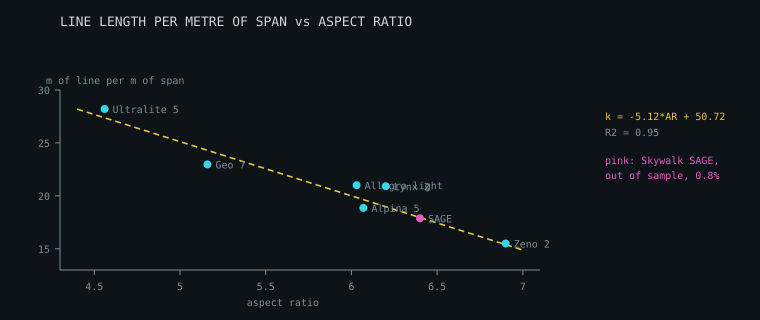

# Size families and scaling

Manufacturers ship a wing in five or six sizes. This is what the measured data
says about how a family is actually related — and where the obvious assumption
fails.

Reference: PHI **ALLEGRO light**, six sizes from 17 to 24 m², in
`data/reference/phi-allegro-light-sizes.tsv`.

---

## 1. The canopy is scaled. Everything attached to it is not.

Fitted across the six sizes, against the span ratio:

| quantity | exponent | reading |
| --- | --- | --- |
| flat area | 1.99 | isometric |
| projected area | 1.96 | isometric |
| maximum chord | 1.02 | isometric |
| minimum chord | 0.96 | isometric |
| **aspect ratio** | — | **constant at 6.03**, spread 0.009 across all six |

So the canopy really is one shape scaled: chord distribution, arc and washin
all carry over, and only a single factor `k = sqrt(areaRatio)` is needed.

The attached parts do not follow:

| quantity | law | R² |
| --- | --- | --- |
| line length | `0.566 × span + 0.459 m` | 0.995 |
| total line length | `21.46 × span − 5.54 m` | 0.983 |
| wing mass | `0.159 × projected area + 0.293 kg` | 0.987 |

All three are **affine, not proportional**. Each has a fixed component that
does not scale — lines are set partly by pilot geometry and handling rather
than by wing size, and mass carries fixed hardware. Scaling a design
isometrically therefore gives lines that are slightly too long on the big
sizes and too short on the small ones.

---

## 2. The limit, which is easy to miss

Fitted to all six sizes, the line-length law is within **0.6%** everywhere.

Fitted to only the three smallest and used to predict the three largest, it
lands **1.83%** out — *worse* than plain isometric scaling at 1.47%.

The reason is the intercept. Over a short baseline the split between the fixed
and the scaling part of a length is poorly determined, and extrapolating
amplifies that error. Isometric scaling has no free parameter to get wrong.
Mass is worse still: 5.9% out on the same test.

So the affine laws are **for interpolation within a measured family**.
`scaleToArea` checks whether the target sits inside the fitted range and falls
back to isometric scaling outside it, rather than trusting a law it cannot
support. Both behaviours are asserted, including the one that says the affine
extrapolation is the worse of the two.

| | method | line-length error |
| --- | --- | --- |
| inside the fitted range | affine | 0.21% |
| outside, falling back | isometric | 1.47% |
| outside, forced affine | affine | 1.83% |

---

## 3. Wing loading is a decision, not a law

A family is not one wing in several sizes. Taking the middle of each certified
weight range:

| size | projected area | mid weight | loading |
| --- | --- | --- | --- |
| XS | 17.49 m² | 62.5 kg | 3.57 kg/m² |
| S | 18.91 | 75.0 | 3.97 |
| M | 20.40 | 85.0 | 4.17 |
| ML | 21.40 | 93.0 | 4.35 |
| L | 22.44 | 100.0 | 4.46 |
| XL | 24.48 | 117.5 | **4.80** |

Loading rises 34% from the smallest size to the largest. Bigger sizes are
flown proportionally heavier, so they fly faster and behave differently — the
sizes in a family are related wings, not interchangeable ones. Anything that
assumes constant loading across a family (a polar, a speed estimate, a load
case) needs the size's own figure.

---

## 4. Cross-family check: the form transfers, the coefficients do not

The laws above were fitted to one family. Checked against two more — Ozone
**Geo 7** (5 sizes) and **Ultralite 5** (7 sizes), spanning 12.9 to 29 m² and
aspect ratios from 4.56 to 6.03:

**Canopy isometry holds everywhere.** Flat-area exponent against span ratio:
1.99 (PHI), 2.00 (Geo 7), 2.08 (Ultralite 5), with aspect ratio held constant
within each family. A single scale factor for the planform is legitimate for
all three.

**The affine form holds everywhere.** Total line length against span:

| family | slope | intercept | R² |
| --- | --- | --- | --- |
| PHI Allegro light | 21.46 | −5.54 | 0.983 |
| Ozone Geo 7 | 26.54 | −40.93 | 0.991 |
| Ozone Ultralite 5 | 36.64 | −76.93 | 0.997 |

Mass against projected area:

| family | slope | intercept | R² |
| --- | --- | --- | --- |
| PHI Allegro light | 0.1588 | +0.2926 | 0.987 |
| Ozone Geo 7 | 0.1270 | +0.9639 | 0.974 |
| Ozone Ultralite 5 | 0.0927 | +0.3871 | 0.999 |

**But the coefficients vary by a factor of about 1.7.** They depend on how
many lines a wing carries, how deep its cascade runs and how it is built — not
on size alone. The Ultralite 5 has 258 line pieces against the Geo 7's 224 and
is a much smaller wing, so its total line length climbs far faster with span.

### The correction this forced

The previous version shipped one family's fit as `DEFAULT_SCALING` and applied
it to anything. That was wrong. Borrowing another family's laws lands more
than 10% out — worse than assuming nothing.

So:

- `scaleToArea` now **scales isometrically unless handed laws fitted to the
  family being scaled**, and reports which it used.
- The PHI fit is renamed `EXAMPLE_SCALING` and documented as a worked example,
  not a default.
- `crossFamilyError` exists to make the non-transferability measurable rather
  than a claim.

Fit your own family with `fitScalingFamily`. Within a family the fitted laws
interpolate to better than 3% on all three.

### A measurement note

Aspect ratio is taken from the maker's published figure where there is one.
Recomputing it from published span and area looks inconsistent even when the
maker holds it fixed: Ozone states 4.56 for all seven Ultralite 5 sizes, but
span and area quoted to one decimal compute anywhere from 4.52 to 4.60. That
spread is rounding, not design, and a fit that treats it as real will reject a
perfectly regular family.

---

## 5. Application: comparisons must be like for like

The cross-family result in section 4 was framed wrongly at first. Comparing a
hike-and-fly wing with a competition wing and calling the difference a scaling
failure is a category error. These wings are built to different briefs, and
almost every ratio that looks like a law tracks the brief.

| wing | application | cert | AR | cells/m span | line m/m² | kg/m² | loading |
| --- | --- | --- | --- | --- | --- | --- | --- |
| Ozone Ultralite 5 | hike and fly | A/B | 4.56 | 3.66 | **13.8** | **0.102** | 4.55 |
| Ozone Geo 7 | progression | B | 5.16 | 4.17 | 10.2 | 0.142 | 3.90 |
| PHI Allegro light | performance XC | C | 6.03 | 5.86 | 10.3 | 0.148 | 4.35 |
| Ozone Zeno 2 | competition | D | 6.90 | 6.05 | **8.3** | **0.217** | 5.05 |

Read as design decisions rather than as quality:

- **Line length per m² falls 40%** from the mountain wing to the competition
  wing. Line drag is a first-order cost to a wing whose job is glide, so it
  carries fewer and thinner lines. The mountain wing carries more per m²
  partly because it is small — line length has a fixed component set by pilot
  geometry, so a 13 m² wing cannot shrink its lines proportionally.
- **Cells per metre of span nearly doubles.** More, narrower cells hold a
  cleaner profile; they also cost weight and build time.
- **Mass per m² doubles**, and the ordering is the reverse of the performance
  ordering. The Ultralite 5 is the lightest per m² because that is its entire
  reason for existing; the Zeno 2 is the heaviest because it is a highly
  loaded competition wing with a dense internal structure.
- **A low aspect ratio is not a worse wing.** It is the right answer to a
  launch in a col with a pack on your back.

`classifyApplication` infers the class from aspect ratio and certification,
`compareApplications` flags a cross-class comparison and says what differs
rather than ranking, and `compareFamilies` reports the normalised metrics and
sorts by application.

### Separating aspect ratio from span — resolved

Earlier this was left open: the total-line-length slope correlates with aspect
ratio at r = −0.96 and with mean span at r = −0.98, and the two are confounded
at r = +0.91, because a higher aspect ratio means a longer span at the same
area. Four families could not separate them.

A fifth family does, through two controlled comparisons:

**Aspect ratio has an effect independent of span.** Geo 7 and Allegro light
are both three-liners with mean spans within **5%** of each other. The
Allegro's aspect ratio is 17% higher and it carries **9% less line per metre
of span**. Span cannot account for that.

**Riser count has a comparable effect.** Allegro light and Alpina 5 have
near-identical aspect ratios — 6.03 and 6.07 — and similar spans, but the
Alpina is a two-liner and carries **10% less line per metre of span**.

Partial correlations agree: controlling for span, slope against aspect ratio
holds at r = −0.86; controlling for aspect ratio, slope against span holds at
r = −0.93. Both effects are real.

### The law that transfers



*Seven families from four manufacturers. The dashed line is the fitted law;
the pink point is Skywalk's SAGE, which was not in the fit and lands within
0.8%.*

Normalising by span removes the dominant size effect and leaves a quantity
that survives leaving its own family:

```
line metres per metre of span  =  -5.12 x AR + 50.72        R² = 0.95
```

| wing | AR | risers | actual | fitted |
| --- | --- | --- | --- | --- |
| Ozone Ultralite 5 | 4.56 | 3 | 28.2 | 27.4 |
| Ozone Geo 7 | 5.16 | 3 | 23.0 | 24.3 |
| PHI Allegro light | 6.03 | 3 | 21.0 | 19.8 |
| Ozone Alpina 5 | 6.07 | 2 | 18.9 | 19.6 |
| Ozone Zeno 2 | 6.90 | 2 | 15.5 | 15.4 |

Predicting any family's total line length from **aspect ratio and span alone**,
with nothing fitted to that family, lands within **6.2%** on all five — across
three manufacturers, two- and three-line wings, and a near 2:1 range in area.
Contrast the raw slope against span, which varied by a factor of 1.7 and did
not transfer at all.

### Tested out of sample — and it broke

BGD's Lynx 2 is a sixth family, a third manufacturer, and none of its data was
used in the fit. Applying the law:

| size | predicted | published | error |
| --- | --- | --- | --- |
| XS | 206.8 m | 209 m | −1.0% |
| S | 214.4 m | 226 m | −5.1% |
| M | 223.9 m | 247 m | −9.3% |
| ML | 233.4 m | 268 m | −12.9% |
| L | 242.9 m | 290 m | **−16.2%** |

Within 1% at the small end and 16% out at the large end. The error is
systematic in size, not scatter, which points at a hidden assumption rather
than noise — and there was one: **that a family's lineset scales with span**.

Fitting the exponent of total line length against the linear scale factor:

| family | exponent | regime |
| --- | --- | --- |
| Ozone Ultralite 5 | 1.30 | span |
| Ozone Geo 7 | 1.15 | span |
| PHI Allegro light | 1.02 | span |
| Ozone Alpina 5 | 1.06 | span |
| Ozone Zeno 2 | 1.04 | span |
| **BGD Lynx 2** | **2.03** | **area** |

A linear scale factor multiplies span by k and area by k², so an exponent near
1 means the lineset scales with span and near 2 means it scales with area.
Five families do the first; BGD does the second, its published totals tracking
area almost exactly.

This is a manufacturer-level design decision, and nothing in a wing's
published numbers reveals which regime it uses — it has to be fitted from the
family, or taken from the maker. `lineLengthExponent` does the fitting, and
`estimateTotalLineLength` takes the exponent and a reference size. Use the
aspect-ratio law to set the *level*, and the family's own exponent to move
*across* sizes.

### Caveats kept with the law

- The aspect-ratio fit rests on five families, which is a small sample for two
  parameters, and it assumes span scaling.
- Riser count is partly collinear with aspect ratio — both two-liners here are
  high-aspect wings — so the two-liner factor is an adjustment, not an
  independently established effect.
- Why BGD scales its lineset with area is not established here. It is a
  2.5-liner, three-line in the centre and two-line at the tip, which is a
  layout no other family in this set uses; whether that is the cause is
  untested.

### BGD publishes its scale factor, and it confirms isometry

Uniquely in this dataset, BGD states a **linear scaling factor** per size —
0.92, 0.96, 1.00, 1.04, 1.08. Against the geometry:

| size | stated | span ratio | √(area ratio) | line length ratio |
| --- | --- | --- | --- | --- |
| XS | 0.92 | 0.9237 | 0.9208 | 0.9178 |
| S | 0.96 | 0.9576 | 0.9555 | 0.9589 |
| ML | 1.04 | 1.0424 | 1.0426 | 1.0411 |
| L | 1.08 | 1.0847 | 1.0835 | 1.0822 |

Agreement to three decimals across span, area and line length. A manufacturer
stating outright the isometric canopy scaling this document derived from
measurements — and the strongest external confirmation of it available.

### A second measurement note

Section 4 noted that aspect ratio recovered from rounded span and area looks
inconsistent. The same rounding breaks scaling exponents. Averaging
`log(v_i/v_0) / log(s_i/s_0)` over the sizes is the obvious estimator and it
is badly behaved: consecutive sizes are close, the ratios are small, and they
carry the full rounding error. On the Zeno 2 that returns **1.86** for an area
that is plainly scaling as the square of span. A least-squares fit on log-log
returns **1.99** from the same figures, and is what the module now uses.

---

## 6. Driving a whole family through the pipeline

`buildFamily` runs geometry, panels, nesting, balance, line plan, loads and
line selection for every size, so a family produces cutting files and line
schedules rather than a table of dimensions.

Two things make it more than a loop, and both show up in the output.

**The canopy scales; the lineset does not.** Every planform length multiplies
by k, so a family shares one shape and the aspect ratio is identical to machine
precision. But line *loads* scale with k², following weight, while a line's
strength scales with its cross-section — so a family's linesets are not similar
to each other and each size must be sized from its own loads.

**Most lines are not load-sized at all.** With the practical floor of 0.50 mm
in place, the interesting output is not the line list but how the load-sized
fraction moves.

### The Ozone Geo 7 family, built

| size | flat area | span | all-up | speed | glide | fabric | line mass | load-sized |
| --- | --- | --- | --- | --- | --- | --- | --- | --- |
| XS | 22.64 m² | 10.69 m | 63 kg | 31.7 km/h | 10.67 | 36.6 m | 69 g | 9/88 |
| S | 24.58 | 11.14 | 75 | 33.4 | 10.68 | 39.1 | 78 | 11/88 |
| MS | 26.32 | 11.52 | 85 | 34.3 | 10.73 | 41.3 | 80 | 12/88 |
| ML | 27.85 | 11.85 | 95 | 35.3 | 10.73 | 42.2 | 91 | 12/88 |
| L | 29.58 | 12.22 | 105 | 36.0 | 10.71 | 45.4 | 108 | 17/88 |

Areas run about 2% above the published figures because the planform is
parametric rather than the real Geo 7 shape; span is set directly and matches
to the rounding in the published data.

### Three results worth having

**The load-sized fraction rises with size** — 10% on the smallest to 19% on the
largest. Loads scale with k² while the floor does not move, so a small wing's
lines are decided almost entirely by handling and a large wing's increasingly
by load. This was the prediction the module was built to test.

**Line mass per square metre rises** — 3.1 to 3.7 g/m² — even though the canopy
is geometrically similar, because bigger wings need thicker line.

**Line drag barely improves with size.** Cx lines moves only 2.8% across a 30%
increase in area, and not even monotonically. The floor caps it: a small wing
is already on the thinnest line available so there is nothing to gain there,
and a large wing's lines are thicker. A designer hoping that a bigger size
would glide better on relatively less line drag does not get it.

---

## 7. What this does not cover

- **Per-family fitting is required.** Three families are now measured and the
  coefficients demonstrably do not transfer. `fitScalingFamily` exists so a
  user fits their own; without one, scaling is isometric.
- **Cell count is held constant** within each family measured — 72, 48 and 34
  respectively — so cell width scales with the wing. Some makers change cell count between sizes,
  which breaks isometry of the panel work.
- **Riser length steps rather than scales** — 570 mm on the two smallest,
  600 mm on the rest — and the speed system travel likewise (150/180 mm).
  Hardware comes in discrete sizes and is not a scaling law at all.
- **Line diameters** are not scaled here. Loads scale with `k²` while a line's
  strength scales with its area, so a family's linesets are not similar
  either; sizing each from its own loads is the right approach and is what
  `loads.js` does.

---

---

## 8. Niviuk, out of sample

Importing a sixth manufacturer, and what the data said about the scaling laws,
is in `docs/niviuk-import.md`.

---

## 9. Generating a family, from the interface

`buildFamily`, `buildSize` and `familyTable` have been in the model since
Phase 2 and there was never a way to ask for them. A designer draws one wing
and needs four.

There is a **Size family** group now — count, smallest and largest area,
all-up mass at each end — and a button that writes the table.

### Two things that had to be right first

**Line length is the line HEIGHT, not the total.** `lineLengthM` is the
distance from karabiner to canopy; `lineLengthPerSpan` gives total metres of
cord. Feeding one where the other belongs would have put 224 m where 6.5 m
goes. Left null entirely, the table came out with **NaN speed and NaN glide on
every row** and 4 of 216 lines load-sized — a table that looked like a table
and told nobody anything.

**A declared base area must match the base geometry.** Every size scales by
`sqrt(area / base.flatArea)`, so a base declared at 22.5 m² whose planform
actually measures 22.91 put every size **1.8% over what was asked for** —
consistently, quietly, and in the direction that makes a wing bigger than its
label.

`buildFamily` now measures the base and refuses a declaration that contradicts
it. But only when it matters: a size may give its scale factor `k` directly,
and then the base area is never read — which is exactly how the Geo 7 family
is validated against published figures its approximated planform does not
match. Checking regardless would have broken a valid case to fix an invalid
one.
